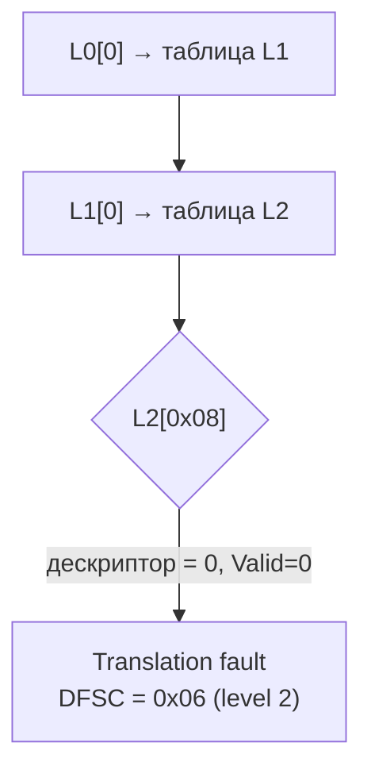

# Декодирование ESR_EL1 на примере реального fault

> [!abstract] Суть
> Провокация записи по `0x1000_0000` дала `EC=0x25, ISS=0x46, FAR=0x10000000`. `ISS=0x46` раскладывается на WnR=1 (запись) и DFSC=0x06 — **translation fault, level 2**: трансляция обрывается в L2-таблице, где слот L2[8] пуст. Обработчик исключений и таблицы MMU показали согласованную картину.

## Раскладка ISS = 0x46 = 0b0100_0110 (Data Abort)

| Биты | Поле | Значение | Смысл |
|---|---|---|---|
| [5:0] | DFSC | `0b000110` = 6 | Translation fault, **level 2** |
| [6] | WnR | 1 | запись |
| [10] | FnV | 0 | FAR валиден |
| [24] | AR | 0 | не RANDTLB |

- EC = 0x25 → Data Abort из current EL (EL1).
- ELR = адрес инструкции `write_volatile`; инструкция **не завершилась** — abort синхронный, транслируется до записи на шину.

## Почему level 2

Маршрут трансляции `0x1000_0000` при нашем раскладе:

- L1-индекс: `0x1000_0000 >> 30 = 0` → ячейка L1[0], указывающая на таблицу L2.
- L2-индекс: `(0x1000_0000 >> 21) & 0x1FF = 8` → пусто → fault.

Сравни: если бы L1[0] был блочным дескриптором, был бы DFSC = 0x05 (level 1); пустой L0 — 0x04.

## Связанные заметки
- [[stage3_interrupts]], [[mmu_basics]], [[a64_assembly_basics]], [[exceptions]]
