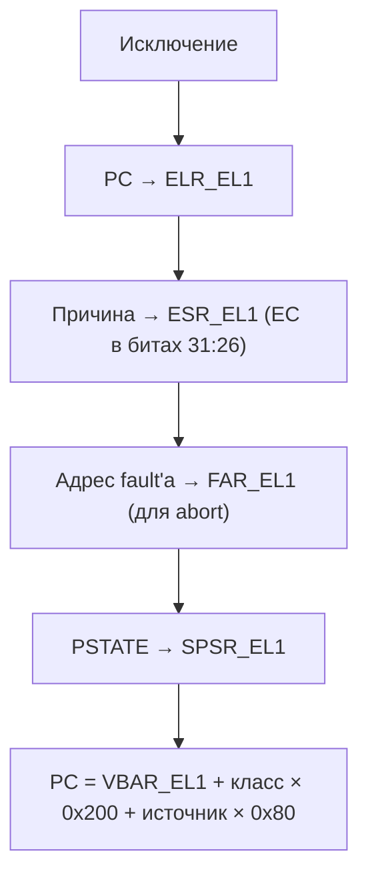

# Исключения AArch64: классы, векторы, VBAR_EL1

> [!abstract] Суть
> Исключение — любое внеплановое событие (fault, IRQ, SVC). CPU сохраняет PC в ELR_EL1, причину в ESR_EL1 и прыгает на VBAR_EL1 + смещение (класс × источник). Пока VBAR=0 — любое исключение = прыжок в никуда = «тихое зависание». После включения таблицы — падения печатаются.

## Что делает CPU при исключении

## Классы (EC в ESR_EL1, биты 31:26)

| EC | Событие | Для проекта |
|---|---|---|
| 0x25 | Data Abort | невыделенная страница, нарушение AP |
| 0x20/0x21 | Instruction Abort | прыжок в мусор |
| 0x15 | SVC | системный вызов |
| 0x3c | BRK | программная точка останова |
| 0x2f | SError | асинхронная ошибка шины |

## Векторная таблица

- 16 слотов × 128 байт (4 класса × 4 источника: same-EL/SP0, same-EL/SPx, lower-EL/AArch64, lower-EL/AArch32).
- **VBAR_EL1** требует выравнивание **2 КБ** (`.align 11` в asm, 2048 в linker.ld).
- Мы живём в EL1 — реально нужны слоты «current EL, SPx»: Sync (0x200) и IRQ (0x280).

## Смещения слотов (current EL, SPx)

| Смещение от VBAR | Класс |
|---|---|
| 0x000 | Sync |
| 0x080 | IRQ |
| 0x100 | FIQ |
| 0x180 | SError |

> [!warning] Асинхронные исключения и ESR
> При IRQ и FIQ `ESR_EL1` **не обновляется**: класс определяется слотом вектора (`0x280` для IRQ). Декодировать `ESR_EL1` в IRQ-обработчике как «причину прерывания» нельзя — там останется значение от прошлого sync-исключения.

> [!warning] Подводные камни
> - Забыть `.align 11` у таблицы → VBAR не примет (проверка только на железе, в QEMU может «сработать»).
> - Забыть `eret` → CPU останется в обработчике навсегда (это ок на этапе 3, но надо осознавать).
> - Забыть `msr vbar_el1` → таблица лежит, но CPU о ней не знает.
> - До включения таблицы любой fault = молчание. Именно поэтому этап начинается с векторов, а не с GIC ([[0003_exceptions_first]]).

> [!question] Самопроверка
> - Почему слотов именно 16, а не 5 (по числу классов)?
> - Что будет при `eret` без сохранённого/восстановленного SPSR_EL1?
> - Какое EC вы увидите при записи в `0xdeadbeef` после включения MMU?

## Источники
- Arm ARM (DDI 0487): Exception levels, Vector tables, ESR_EL1
- AArch64 Programmer's Guides: Exception handling

## Связанные заметки
- [[0003_exceptions_first]], [[qemu_adaptation]], [[mmio_basics]], [[mmu_basics]]
