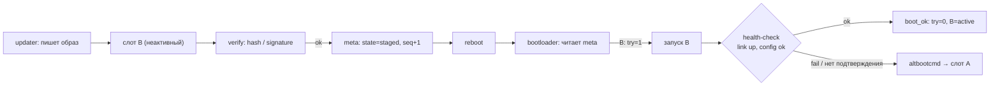
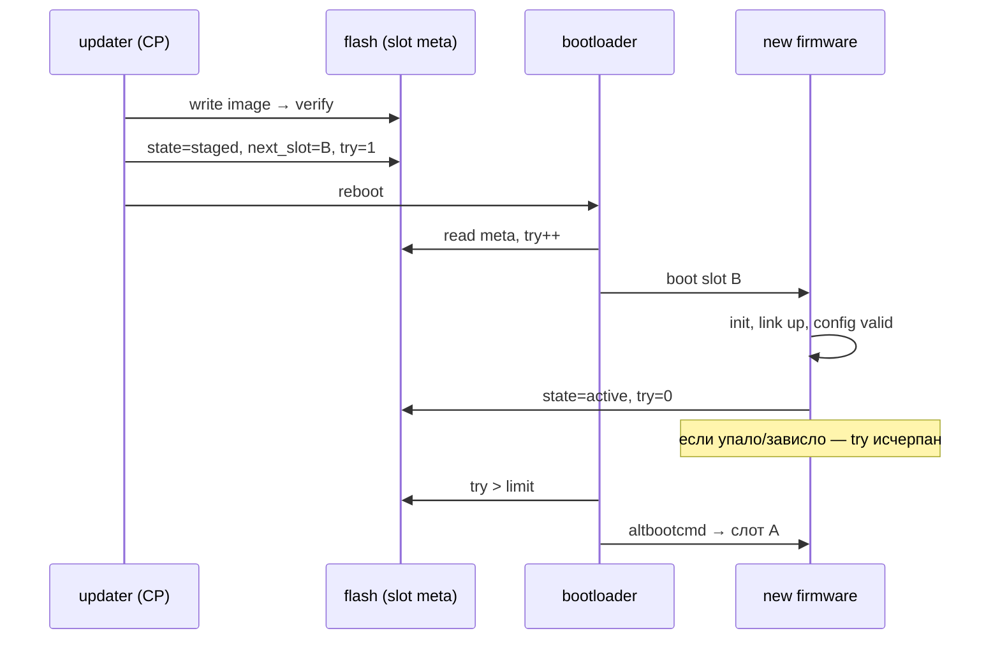

# Как обновляют прошивки в сетевых устройствах

> [!abstract] Суть
> Почти все сетевые устройства обновляются **через загрузчик**: новый образ пишется во flash, загрузчик выбирает, что запускать, и умеет откатиться. «Безопасное» обновление — это не транспорт, а четыре независимых механизма: **два банка/слота**, **счётчик попыток загрузки + health-check**, **целостность/подпись** и **отдельно хранимый конфиг**. Настоящий hot-swap ОС (ISSU) есть только у carrier-grade шасси с резервной control plane; в SOHO/CPE всё сводится к «перезаписать неактивный слот → перезагрузиться → подтвердить здоровье».

## Четыре слоя, которые надо не путать

| Слой | Вопрос | Типичные решения |
|---|---|---|
| Хранилище | куда писать образ | один банк + recovery, A/B, golden image, пакеты |
| Управление загрузкой | что запускать и когда откатиться | `bootcount`/`altbootcmd`, trial boot, watchdog |
| Доверие | откуда известно, что образ «наш» | CRC → hash → подпись → secure boot, anti-rollback |
| Доставка | кто и как принёс байты | TR-069/ACS, облако вендора, TFTP/USB/SD, NETCONF |

Транспорт (HTTP/TFTP) — самая простая часть. Устройства ломаются не из-за транспорта, а из-за отключения питания посреди стирания flash и из-за неудачного образа без отката.

## Схемы размещения образа

| Схема | Как работает | Цена | Где встречается |
|---|---|---|---|
| **Single bank + recovery** | один образ; при провале — режим восстановления (TFTP, кнопка Reset, ROM-USB) | дешево по flash; откат = ручное вмешательство | домашние роутеры, Ubiquiti (TFTP recovery), BootROM-режимы SoC |
| **A/B (dual bank)** | два слота; пишем в неактивный, грузимся с него, старый — резерв | 2× flash | Android A/B, ESP32 OTA, современные CPE |
| **Golden image + main** | неизменяемый образ восстановления + рабочий | +1 небольшой образ | ONT, промышленные устройства, «failsafe» OpenWrt |
| **Пакетное обновление** | обновляются отдельные компоненты (ядро, rootfs, приложение) | сложнее версии | OpenWrt `opkg`, Linux-прошивки, SONiC |
| **Два супервизора / ISSU** | обновляется standby control plane, затем переключение | очень дорого | Cisco/Juniper chassis, операторские маршрутизаторы |



## Управление загрузкой и откат

Механика в U-Boot (и её аналоги в других загрузчиках):

- `bootcount` увеличивается на каждой загрузке, `bootlimit` задаёт порог, `altbootcmd` — что делать при превышении; успешная прошивка обязана **сбросить** счётчик (`bootcount reset`).
- Альтернатива: флаг `boot_ok`/`try` в метаданных слота; прошивка ставит его только после health-check (линк поднялся, конфиг валиден, N секунд без паники).
- Аппаратный watchdog страхует зависание до health-check; связка «watchdog + bootcount» закрывает и «ядро упало», и «ядро зависло».
- Trial boot: счётчик попыток живёт в энергонезависимом месте (env загрузчика, OTP, RPMB, отдельный блок метаданных), а не в RAM.



## Целостность и доверие

Цепочка должна быть непрерывной, иначе подпись — самоуспокоение:

```text
BootROM (hash ключа в OTP/eFuse)
   → bootloader (подписан) 
   → образ (подпись + hash)
   → rootfs (dm-verity / IMA, если есть ОС)
```

- **CRC** ловит обрыв записи, но не подмену; **SHA-256** — целостность; **Ed25519/RSA** — подлинность.
- **Anti-rollback**: счётчик версии в OTP/eFuse или RPMB; без него злоумышленник откатывает на версию с известной уязвимостью.
- **Проверка модели/ревизии платы** внутри образа: прошивка «не для этого железа» — частая причина кирпича.
- Если загрузчик не проверяет подпись, подпись защищает только канал доставки: с физическим доступом (`go`, UART, JTAG) можно загрузить что угодно.

## Энергонезависимость: правила, которые нельзя нарушать

- Никогда не стирать единственную рабочую копию.
- Метаданные — **последними** и **в двух копиях** с `seq` + CRC: читается та, у которой `seq` больше и CRC сходится.
- Писать образ целиком и проверять чтением (read-back), а не «по ответу 200 OK».
- Учитывать природу носителя: NAND — бэд-блоки и ECC (UBI), eMMC — аппаратные boot-разделы, SD — внутренний FTL **без гарантии атомарности** блока при отключении питания.
- Тестировать стендом с реле питания: обрыв в момент стирания/записи — обязательный тест-кейс.

## Конфиг и состояние

- Конфиг живёт **отдельно** от образа: обновление прошивки не должно его терять, а сброс конфига не должен откатывать прошивку.
- `schema_version` + мигратор; конфиг новее прошивки — отказ (или миграция вниз, если предусмотрена).
- Заводские дефолты — **в образе**, чтобы устройство поднялось с пустым/битым носителем.
- Счётчики и статистика — в RAM, не в конфиг (износ + потеря при выключении).
- На роутерах с NVRAM конфиг часто отдельный раздел (`nvram commit` у Broadcom, `jffs2`/UBI-volume у OpenWrt).

## Кто инициирует обновление

| Сегмент | Канал | Механика |
|---|---|---|
| ISP-оборудование (CPE, ONT) | **TR-069/CWMP + ACS** | ACS вызывает `Download` с `FileType` = *1 Firmware Upgrade Image* (2 — веб-контент, 3 — конфиг), CPE скачивает, применяет, перезагружается, отчитывается `Inform`-событиями |
| То же, новее | TR-369 (USP) | pub/sub, MTP (WebSocket/MQTT), те же операции |
| Enterprise | контроллер/облако вендора (UniFi, Meraki, Omada), NETCONF/YANG | staged rollout, группы устройств, окна обслуживания |
| Операторский транспорт | NETCONF/YANG + ISSU | обновление по одному узлу, hitless |
| Лаборатория/разработка | TFTP, USB, SD | `tftp` + `go`, `fatload`, `sysupgrade` |

Раскатка почти всегда **поэтапная**: канареечная группа → процент → все; с автоматической остановкой по метрикам (reboot loop, рост ошибок).

## ISSU: когда обновление «без простоя»

Требуется резервная control plane (два RE/супервизора) и разделение плоскостей:

- data plane продолжает коммутировать по текущим таблицам, пока новая control plane поднимается и синхронизирует состояние;
- NSF/GR (nonstop forwarding / graceful restart) не дают соседям заметить перезапуск протоколов;
- версии ПО на двух RE должны быть совместимы по протоколу синхронизации;
- цена — двойное железо и сложность; для SOHO неприменимо.

## Примеры

| Устройство | Механика |
|---|---|
| OpenWrt | `sysupgrade` пишет образ в раздел прошивки (на части целей — alternate layout), конфиг сохраняется; `failsafe` — аварийный режим; U-Boot `bootlimit`/`altbootcmd` |
| ESP32 (IoT) | два app-раздела + `otadata` с seq; загрузчик выбирает; `esp_ota_mark_app_valid_cancel_rollback()` подтверждает здоровье |
| Android | A/B-слоты, `slot_suffix`, `boot_control` HAL, Verified Boot (AVB), rollback index в защищённом хранилище |
| Cisco IOS/NX-OS | ROMMON + список образов в bootflash, fallback; ISSU на шасси с двумя супервизорами |
| Juniper Junos | два Routing Engine; `request system software add`, `request system software rollback` |
| MikroTik | RouterBOOT, опция «keep old booter», восстановление через Netinstall |
| Ubiquiti | TFTP recovery по удержанию Reset |

## Как это соотносится с нашим проектом

[[0011_update_and_slots]] уже выбирает мейнстрим: обновляет U-Boot, прошивка только просит перезагрузку; A/B-слоты на SD; `bootcount`; конфиг в двух копиях с CRC и `schema_version`. Сейчас (этап 0–9) — TFTP + `go`, то есть роль загрузчика минимальна ([[uboot_loading]]). Появление заголовка образа потребует либо raw + метаданные отдельно, либо `bootelf`/FIT.

> [!warning] Частые способы получить «кирпич»
> - стирание активного слота «чтобы не тратить место»;
> - метаданные без двойной копии и `seq` — питание пропало, слот не опознан;
> - образ без проверки модели/ревизии;
> - downgrade на уязвимую версию без anti-rollback;
> - обновление загрузчика тем же механизмом, что и прошивки, без второй копии;
> - «подпись есть» при незащищённом загрузчике.

> [!question] Для самопроверки
> - Почему `bootcount` надо сбрасывать из прошивки, а не из загрузчика?
> - Чем CRC метаданных отличается от подписи образа и что каждое защищает?
> - Почему ISSU невозможен без резервной control plane?
> - Что произойдёт с конфигом старой схемы после отката на предыдущую прошивку?

## Источники
- TR-069 (CWMP), Annex: `Download` RPC, `FileType` 1/2/3; TR-369 (USP).
- U-Boot: `CONFIG_BOOTCOUNT_LIMIT`, `bootlimit`, `altbootcmd`, `bootelf`, FIT/`mkimage`.
- OpenWrt: `sysupgrade`, failsafe, alternative partition layouts.
- Android A/B updates: `boot_control` HAL, `slot_suffix`, AVB rollback index.
- RFC 6234 (SHA-256), RFC 8032 (Ed25519).

## Связанные заметки
- [[0011_update_and_slots]], [[uboot_loading]], [[load_address]], [[0004_baremetal_vs_linux]], [[0012_protection_module_loading]]
