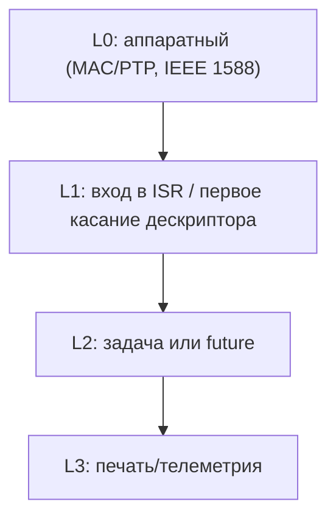

# Измерение задержки: где ставить таймстамп

> [!abstract] Суть
> Точность интервала определяется **разрешением счётчика и джиттером момента взятия отсчёта**, а не частотой опроса. Поэтому вопрос «как часто проверять» вторичен: сначала выбирается точка, в которой берётся `CNTPCT_EL0` (или аппаратный PTP-таймстамп), и только потом — модель конкурентности.

## Три разные величины, которые путают

| Термин | Что это | Чем задаётся |
|---|---|---|
| Разрешение (resolution) | шаг счётчика | `CNTFRQ_EL0` (24 МГц → 41.7 нс; 62.5 МГц → 16 нс) |
| Точность/джиттер (accuracy, jitter) | разброс момента взятия отсчёта | путь до кода, кэши, IRQ, планировщик |
| Частота выборки (sampling rate) | сколько измерений в секунду | как часто запускается измерение |

**Вывод:** «очень часто опрашивать» увеличивает только третью строку. Если отсчёт берётся в случайный момент, миллион опросов в секунду даст миллион неточных отсчётов.

## Бюджет задержки пакета

Порядок величин (проверять на железе, не в QEMU):

| Источник | Порядок | Как убрать |
|---|---|---|
| Кадр на проводе, 64 Б | ~0.67 мкс | никак (физика) |
| Кадр на проводе, 1500 Б | ~12 мкс | никак (физика) |
| `ICC_IAR1_EL1` + переход на вектор | ~0.3–2 мкс | аппаратный таймстамп до IRQ |
| Промах кэша/TLB при первом обращении в ISR | до единиц мкс | не трогать лишнюю память в ISR |
| Scheduler/executor: wake + switch + холодные кэши | ~1–20 мкс, тяжёлый хвост | таймстамп **до** очереди |
| `println!` в пути | **десятки–сотни мкс** | запретить печать в data plane |
| Квант таймера 4 Гц | 250 мс | не использовать для измерения |

> [!warning] UART в горячем пути
> На 1 500 000 бод один байт ≈ 6.7 мкс, строка в 30 символов ≈ 200 мкс. Печать внутри обработки пакета — самый большой источник джиттера в проекте, больше любого планировщика.

## Три уровня взятия таймстампа

- **L0 — аппаратный.** MAC пишет метку времени в RX/TX-дескриптор. Софт не влияет вообще; джиттер ≈ 0, точность до наносекунд. Требует проверки: есть ли PTP в GMAC RK3566 и в RTL8211F (смотреть TRM RK3566, раздел GMAC, и datasheet PHY).
- **L1 — ISR.** Джиттер — только вход в исключение. Планировщик не участвует.
- **L2 — задача/future.** Сюда добавляется wake, решение планировщика, переключение стека, холодные кэши. Для *измерения* это худший вариант; для *агрегации* — нормальный.

### Систематическая ошибка vs джиттер

Если старт и финиш измеряются на одном уровне, **постоянная** составляющая (например, вход в ISR) вычитается и сокращается. **Случайная** — нет: `σ` складывается. Поэтому нельзя «компенсировать» джиттер, взяв отсчёт позже.

## Polling vs IRQ

Контринтуитивный момент:

| | IRQ | Busy-poll |
|---|---|---|
| Точность момента события | высокая (событие → метка) | ограничена периодом опроса (квантование) |
| Равномерность | джиттер входа в исключение | ровная, без выбросов |
| Цена | контекст входа | занятое ядро, давление на кэш |
| С аппаратным таймстампом | избыточен | **лучший вариант**: метка точная, опрос ничего не портит |

То есть «точность против планировщика» решается не ускорением планировщика, а **удалением программного слоя из точки измерения**.

## Методика: измерить, а не угадать

1. Взять `CNTPCT_EL0` в трёх точках: вход в ISR, перед `poll`, после `poll`.
2. Складывать дельты в статический массив (без аллокаций).
3. Через N сэмплов посчитать p50/p99/max и **напечатать один раз**, вне горячего пути.
4. Повторить под нагрузкой (burST TX, другой трафик, конкурирующие задачи).

В QEMU это бессмысленно: время виртуальное, TCG не воспроизводит задержки. Функциональные тесты — в QEMU, джиттер — только на NanoPi.

## Подводные камни

> [!warning]
> - Считать, что async убирает джиттер: он убирает *вытеснение*, но не задержку «пока текущий future не вернул `Pending`».
> - Печатать метрики из ISR.
> - Мерить в QEMU и делать выводы о железе.
> - Забыть про cache maintenance при DMA: инвалидация линий на каждый пакет — заметная и нестабильная задержка.
> - DVFS: на голом металле частота зафиксирована тем, что выставил загрузчик; если позже включить управление частотой, джиттер изменится скачком.
> - `CNTVCT_EL0` зависит от `CNTVOFF_EL2`; `CNTPCT_EL0` — нет. Для дельт годится любой, для абсолютных меток и сверки с PTP — только физический.

## Источники
- Arm ARM (DDI 0487): Generic Timer, `CNTPCT_EL0`, `CNTFRQ_EL0`
- TRM RK3566: GMAC, PTP/1588 (проверить), `timer` clock-frequency
- IEEE 1588-2019 (PTP): аппаратные метки RX/TX
- Linux `stmmac` + `ptp_clock`: как драйвер забирает HW-таймстамп из дескриптора

## Связанные заметки
- [[arm_generic_timer]], [[irq_entry_exit]], [[0006_data_plane_async]], [[task_and_scheduler]]
