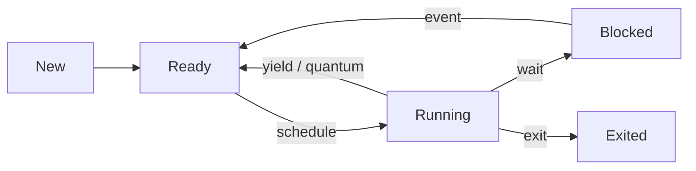

# Задачи и планировщик

> [!abstract] Суть
> Задача — это стек, сохранённый контекст и состояние. Планировщик выбирает следующую Ready-задачу и переключает контекст. Сначала делаем cooperative (добровольный `yield`), затем preemptive (по таймеру).

## Из чего состоит задача

Task Control Block (TCB):

| Поле | Зачем |
|---|---|
| `state` | Ready / Running / Blocked / Exited |
| `ctx` | сохранённые регистры + SP |
| `stack` | базовый адрес и вершина стека |
| `entry` | точка входа для новой задачи |
| `id` | отладочная метка |

Стек у каждой задачи **свой**. Иначе задачи затрут кадры друг друга.

## Состояния



Для первого milestone достаточно `Ready`/`Running` и idle-задачи.

## Политика

- **Round-robin**: после Running задача возвращается в конец Ready-очереди.
- **Quantum**: сколько тиков задача может работать до принудительного переключения (только для preemptive).
- **Idle**: если Ready-очередь пуста, запускается задача `loop { wfi }`.

Очередь лучше держать фиксированной (`[Task; N]` + индекс), без аллокаций в планировщике.

## Cooperative vs preemptive

| | Cooperative | Preemptive |
|---|---|---|
| Когда переключение | задача сама вызывает `yield_now()` | таймер/IRQ отбирает CPU |
| Что нужно сохранить | callee-saved + SP + LR | полный контекст + ELR/SPSR |
| Сложность | низкая | высокая: IRQ-trampoline и стек |
| Риск | задача может монополизировать CPU | гонки с ISR, deadlock с lock'ами |

Начинать надо с cooperative: он позволяет отладить TCB, стеки и `sched_switch` без переделки IRQ-векторов.

## Кто кого вызывает

```text
main → sched::init() → sched::spawn(task_a) → sched::spawn(task_b)
     → sched::start()  // больше не возвращается
task_a → println → yield_now → sched_switch → task_b
task_b → println → yield_now → sched_switch → task_a
```

## Связанные заметки
- [[context_switch]], [[stage5_scheduler]], [[spinlock]], [[arm_generic_timer]], [[irq_entry_exit]]
