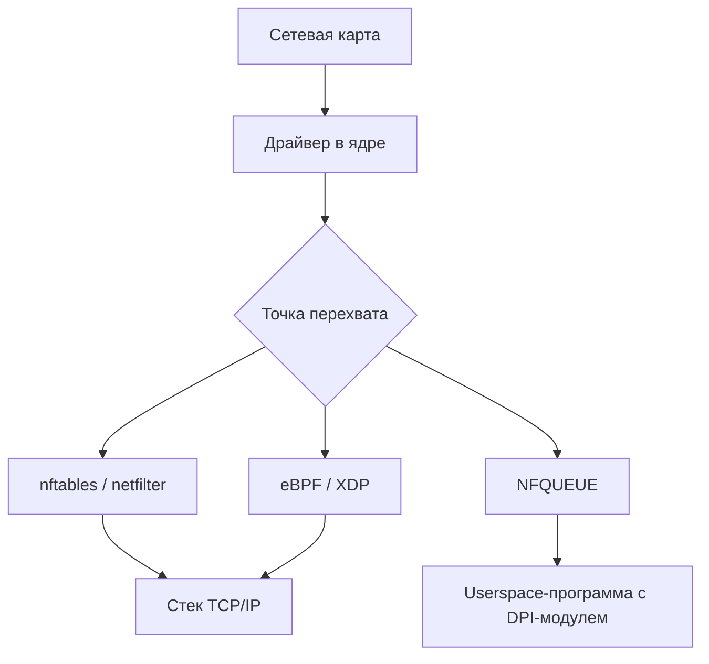

# 0004 — Bare-metal vs готовая ОС (Linux) для файрвола

> [!abstract] Суть
> Сравнение текущего подхода (bare-metal) с написанием файрвола поверх готовой ОС. Bare-metal берут ради полного контроля и in-line производительности; Linux — ради скорости разработки и готового сетевого стека. Проект осознанно выбирает bare-metal как учебный путь.

## Что отпадает на Linux

Этапы 0–8 из README — это ровно то, что ядро Linux делает за нас:

| Bare-metal этап | На Linux |
|---|---|
| `start.s`, парковка ядер, `.bss` | bootloader + ядро |
| MMU, таблицы страниц, аллокатор | ядро; процессы, `mmap` |
| GIC, векторные таблицы | API прерываний ядра |
| SpinLock / синхронизация | `std::sync` |
| Планировщик | CFS/EEVDF в ядре |
| Драйвер Ethernet | готовый драйвер в ядре |
| ARP/IP/ICMP/TCP/UDP | сетевой стек ядра |
| U-Boot + TFTP | загрузка образа с SD |

## Что появляется взамен

Точки перехвата трафика в Linux:

- **nftables** — декларативные правила; conntrack и NAT уже реализованы (`conntrack.rs`/`nat.rs` становятся конфигом).
- **eBPF/XDP** — свой код в ядре, но ограниченный C (есть Rust-обвязка Aya).
- **NFQUEUE** — путь zapret: пакеты копируются в userspace; минус — копирование на каждый пакет. Именно это — мотивация bare-metal в README («Почему не zapret напрямую»).

## Сравнение

| | Bare-metal | Linux |
|---|---|---|
| Время до результата | месяцы | дни |
| Производительность | потолок — свой код | ограничена стеком ядра (XDP сложен) |
| Обучение | устройство ОС и сети изнутри | сетевые API и администрирование |
| Контроль над пакетом | полный, in-line | через точки перехвата |
| Цена ошибки | зависание/ребут платы | падение процесса |
| DPI | свой egress-модуль | zapret готовый |

## Решение

Проект учебный: цель — понять, *как устроена* ОС и сеть, а не быстро получить продукт. Bare-metal сохраняется. Linux-вариант — разумная альтернатива для «продуктового» форка проекта, если учебная цель будет достигнута.

> [!question] Для самопроверки
> - Почему NFQUEUE медленнее in-line обработки в bare-metal?
> - Что из этапов 0–8 останется полезным, если позже перейти на Linux (подсказка: Aya, DPDK)?
> - Чем XDP принципиально отличается от NFQUEUE по месту обработки пакета?

## Источники
- README.md, раздел «Ключевые решения» («Почему не zapret напрямую»).
- OSTEP — про слои абстракции, которые на bare-metal пишутся руками.

## Связанные заметки
- [[mmu_basics]], [[global_alloc]], [[exceptions]], [[stage3_interrupts]]
