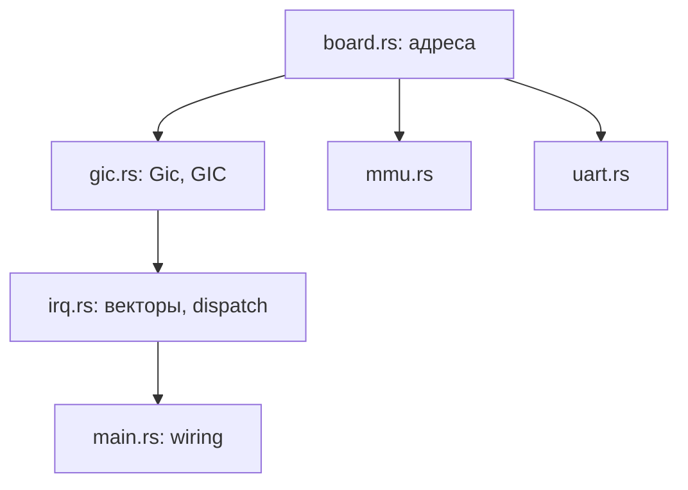

# ADR-0005: board.rs и gic.rs

> [!abstract] Суть
> Адреса платы (RAM, GICD, GICR, UART) выносим в `board.rs`; регистры и операции GICv3 — в `gic.rs` (`Gic` + статик `GIC`). `irq.rs` оставляет векторы, `VBAR_EL1` и диспетчеризацию; таймер позже выносится в `timer.rs`.

## Контекст

Сейчас адреса QEMU (`0x0800_0000`, `0x080A_0000`, `0x0900_0000`) размазаны по `irq.rs`, `mmu.rs`, `uart.rs`. GIC-код смешан с векторами и таймером. Перед переносом на NanoPi нужен один слой адресов и один слой драйвера GIC.

## Решение

### board.rs — только адреса платы

```rust
//! Адреса платы. Сейчас — QEMU virt.
pub const BOARD_NAME: &str = "QEMU virt";
pub const RAM_BASE: usize = 0x4000_0000;
pub const GICD_BASE: usize = 0x0800_0000;
pub const GICR_RD_BASE: usize = 0x080A_0000;
pub const UART_BASE: usize = 0x0900_0000;
```

Смещения регистров GIC сюда **не** кладём: они архитектурные и живут в `gic.rs`.

### gic.rs — драйвер GICv3

- приватные смещения/маски (`GICD_CTLR`, `GICR_WAKER`, `GICR_IGROUPR0`, `GICR_ICFGR1`, `GICR_IPRIORITYR`, `ICC_*`);
- `pub struct Gic { gicd: usize, gicr_rd: usize }`;
- `pub static GIC: Gic = Gic::new(board::GICD_BASE, board::GICR_RD_BASE);`;
- методы: `init()`, `enable_ppi(intid, priority)`, `ack()`, `eoi(iar)`;
- `pub const SPURIOUS_INTID: u32 = 1023;`.

`gic.rs` не знает про таймер: `TIMER_INTID`/`TIMER_PRIORITY` передаются в `enable_ppi` извне.

### irq.rs — векторы и диспетчеризация

- `global_asm!`, `init()` (VBAR), `unexpected`, `sync_handler`;
- `irq_handler`: `ack() → intid → обработчик → eoi()`;
- GIC-константы и `init_gic()` удаляются.

### timer.rs — следующий шаг

`timer.rs` забирает `TICKS`, `CNTFRQ_EL0`, `TVAL`, `start_timer()` и константы `INTID`/`PRIORITY`. API:

- `pub const INTID: u32 = 27;`
- `pub const PRIORITY: u8 = 0xA0;`
- `pub unsafe fn init()` — читает частоту, проверяет `!= 0`, пишет `CNTV_TVAL/CNTV_CTL`;
- `pub unsafe fn on_irq()` — перезаряжает `TVAL`, инкрементит `TICKS`;
- `pub fn ticks() -> u32`;
- `static TVAL: AtomicU32` — кэш, чтобы не читать `CNTFRQ_EL0` в каждом прерывании;
- `static TICKS: AtomicU32` — счётчик для `main`.

`irq.rs` вызывает только `timer::on_irq()` и **не делает EOI за него**: EOI остаётся в диспетчере после возврата из обработчика. `gic.rs` вообще не знает про таймер.

## Зависимости



Направление строго вниз: `board` не зависит ни от чего; `gic` зависит от `board`; `irq` зависит от `gic`; `main` связывает всё.

## Последствия

- + перенос на плату меняет один `board.rs`, а не три файла;
- + GIC можно читать и тестировать отдельно от векторов;
- + `irq.rs` перестаёт быть «всё про прерывания»;
- − `gic.rs` зависит от `board.rs` (для статика `GIC`); при нескольких платах — `cfg`-выбор констант;
- − `linker.ld` (база `0x4200_0000`) остаётся вне `board.rs`: это контракт с загрузчиком, а не адрес MMIO.

## Мультиплатформенность

Пока хватает одного `board.rs`. Когда появятся адреса RK3566:

```toml
[features]
default = ["board-qemu"]
board-qemu = []
board-nanopi = []
```

и `#[cfg(feature = "board-qemu")]` / `#[cfg(feature = "board-nanopi")]` вокруг констант. Вводить features раньше, чем известны адреса платы, — лишняя сложность.

## Связанные заметки
- [[gic_v3]], [[stage3_precommit]], [[memory_barriers]], [[0002_global_uart_handle]]
