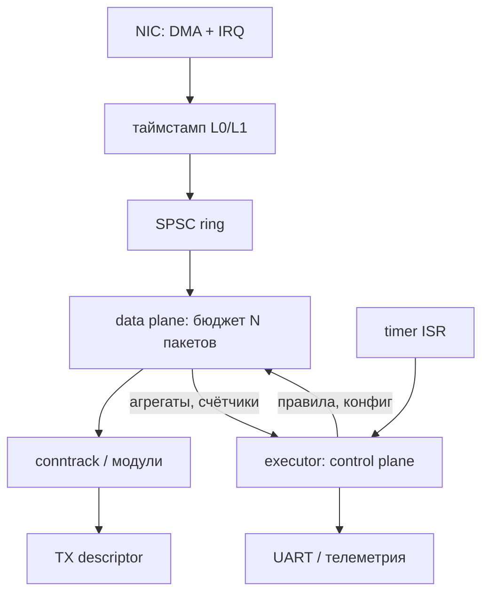

# ADR-0006: планировщик vs async executor для трафика

> [!abstract] Суть
> Для data plane отказываемся и от preemptive-планировщика, и от «executor в горячем пути»: пакет обрабатывается **run-to-completion** в ISR/цикле опроса с бюджетом на порцию, а таймстамп берётся до попадания в любую очередь. Async executor (Embassy-подобный) — для control plane. Статус: **предложено, решение не принято** — зависит от того, что именно измеряется и с какой точностью.

## Контекст

Планируется алгоритм защиты, которому нужна метрика «время отклика на порту». Опасение: переключение контекста планировщиком даёт неопределённость. Текущее состояние проекта:

- этап 5 не начат, `scheduler.rs` — заглушка с policy-API;
- таймер 4 Гц (квант 250 мс);
- одно ядро активно, три припаркованы;
- `println!` идёт через `SpinLock<Uart>`, heap — тоже под замком;
- отладка в QEMU virt (тайминги там не настоящие).

## Варианты

### A. Preemptive round-robin (текущий план этапа 5)

Задача-обработчик вытесняется таймером; таймстамп берётся в задаче.

- + учебная ценность: IRQ-кадр, `eret`, TCB;
- − максимальный джиттер: вытеснение + переключение стека + холодные кэши + ожидание кванта;
- − гонки с ISR, priority inversion на `SpinLock`;
- − квант 250 мс несопоставим с задачей (нужен 1 кГц);
- **вывод:** как учебный этап — да; как путь пакета — нет.

### B. Async executor (Embassy-подобный) на всё

Один executor, задачи — futures, ISR будит waker.

- + нет per-task стеков, нет вытеснения, компилятор строит state machine;
- + естественно ложится на `smoltcp` (у него `poll`-модель);
- − это **не** модель реального времени: задержка «IRQ → waker → poll» остаётся, просто без переключения стека;
- − кооперативность = head-of-line blocking: длинный `poll` тормозит всех;
- − официальная поддержка AArch64 в `embassy-executor` требует проверки; для учебного проекта свой executor на ~150 строк может быть полезнее;
- **вывод:** хорошо для control plane, рискованно как единственная модель для пакетов.

### C. Двухплоскостная архитектура (рекомендуется)

**Data plane:** IRQ (или busy-poll) → таймстамп → SPSC-кольцо → цикл разбора с бюджетом (N пакетов или T мкс) → conntrack/модули → TX.
**Control plane:** executor с futures: ARP-таймеры, DHCP, телеметрия, watchdog, конфиг.

- + путь пакета не зависит от планировщика вообще;
- + бюджет на порцию ограничивает head-of-line blocking;
- + исполнитель можно менять, не трогая data plane;
- − две модели в одном проекте, нужна дисциплина по границам (очереди, атомики);
- − нужен явный механизм «проснуться по пакету» из IRQ.

### D. Приоритеты и вложенность GIC вместо смены модели

Оставить прерывания, но настроить приоритеты/группы: критичный по времени ISR вытесняет обработку пакета (Group 0 → FIQ, вложенные IRQ через priority drop).

- + минимальная переделка, аппаратный механизм;
- − требует реентерабельного кода и per-priority стеков;
- − не помогает, если таймстамп всё равно берётся в задаче.

## Сравнение

| Критерий | A preemptive | B async всё | C две плоскости | D приоритеты |
|---|---|---|---|---|
| Джиттер в пути пакета | высокий | средний | **низкий** | низкий |
| Предсказуемость | низкая | средняя | **высокая** | высокая |
| Сложность | высокая | средняя | средняя | высокая |
| Учебная ценность | высокая | высокая | средняя | высокая |
| Готовность к SMP | плохая | хорошая | **хорошая** | хорошая |
| Риск для этапа 5 | нет | нет | нет | нет |

## Предварительное решение

1. **Таймстамп — до любой очереди.** Точка L0 (PTP в MAC), если железо поддерживает; иначе L1 (первые инструкции ISR). В задаче/future метку не брать.
2. **Data plane — run-to-completion с бюджетом**, без вытеснения. Это же и есть NAPI-модель.
3. **Control plane — executor.** Взять Embassy или написать свой; критерий — есть ли AArch64-поддержка и насколько хочется разбирать waker-механику руками.
4. **Этап 5:** cooperative-планировщик реализовать (он же каркас для executor), preemptive — опционально, как учебное упражнение; в путь пакета его не пускать.
5. **SMP позже:** ядро 0 — data plane busy-poll, ядро 1 — executor; fast path без общих `SpinLock`.

## Последствия

- + измерение перестаёт зависеть от модели конкурентности;
- + можно начинать драйвер Ethernet, не дожидаясь выбора executor'а;
- − нужны SPSC-очереди и правило «в ISR только таймстамп + enqueue»;
- − бюджет на порцию надо подбирать (метрика: p99 задержки и пропускная способность);
- − `println!` из data plane запрещён: только счётчики.

## Открытые вопросы

> [!question]
> - Что именно измеряем: RTT удалённого узла, своё время обработки (SYN → SYN-ACK) или интервалы между пакетами?
> - Какая нужна точность: нано/микро/миллисекунды, и какие перцентили (p50/p99/max)?
> - Какой ожидаемый pps и сколько портов/потоков одновременно?
> - Нужна ли аппаратная метка PTP (и есть ли она у GMAC RK3566 + RTL8211F)?

## Связанные заметки
- [[latency_measurement]], [[task_and_scheduler]], [[context_switch]], [[stage5_scheduler]], [[multicore_path]], [[arm_generic_timer]], [[spinlock]]
