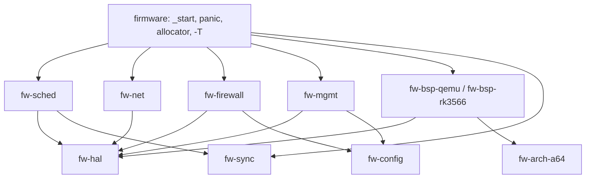

# ADR-0008: workspace и разбиение на крейты

> [!abstract] Суть
> Разбивать проект нужно **по границе «политика / механизм / железо»**, а не «по файлам»: чистая логика (очередь задач, правила файрвола, конфиг) уезжает в `no_std`-крейты без MMIO и asm и получает host-тесты; asm и адреса платы остаются в `arch`/`bsp`; `#[panic_handler]`, `#[global_allocator]`, `_start` и `-Tlinker.ld` живут только в финальном бинарнике. Переезд — инкрементальный, по мере этапов, а не big-bang.

## Контекст

Сейчас один бинарник, 9 модулей в `src/`. Что уже мешает и что помешает на этапах 6–9:

- `cargo clippy --all-targets` не работает: у `aarch64-unknown-none` нет test harness ([[stage3_precommit]]);
- host-тестов нет вообще, хотя `SpinLock` уже архитектурно независим ([[no_std_testing]]);
- любая правка пересобирает всё, включая asm и линковку;
- логика будущего файрвола (сопоставление правил, conntrack) будет зависеть от `uart`/`board`/`timer`, хотя ей нужны только байты;
- при запуске на NanoPi понадобится второй набор адресов — если он ляжет в `board.rs` рядом с QEMU, начнётся `#[cfg]`-каша;
- `panic = "abort"` и линковка живут в одном манифесте с «библиотечным» кодом.

## Правило разделения

| Слой | Что внутри | Зависит от | Тестируется на хосте |
|---|---|---|---|
| **policy** | очередь задач, события, правила, conntrack, разбор конфига | только `core` (+`alloc`) | **да** |
| **hal** | трейты `Console`, `Timer`, `Intc`, `NetDevice` | `core` | компиляцией |
| **arch** | `start.s`, векторы, `sched_switch`, обёртки sysreg, барьеры | `core` | нет (QEMU) |
| **bsp** | адреса и последовательности init для конкретной платы | `arch`, `hal` | нет (QEMU/плата) |
| **firmware** | `_start`, `#[panic_handler]`, `#[global_allocator]`, сборка графа | всё | нет |

Ключевое: **зависимости направлены только вниз** (`firmware → policy/net → hal → arch → core`). Если `fw-sched` начал знать про MMIO — граница проведена неверно.

## Целевая структура

```text
bare-metal-firewall/
├── Cargo.toml                  # [workspace]: members, workspace.dependencies, lints, profiles
├── .cargo/config.toml          # target, linker, runner, алиасы
├── linker.ld                   # один на всех (база 0x42000000)
├── crates/
│   ├── fw-sync/                # SpinLock, IrqSafeSpinLock          (host-тесты)
│   ├── fw-arch-a64/            # start.s, irq_vectors.s, sched_switch, sysreg
│   ├── fw-hal/                 # трейты Console/Timer/Intc/NetDevice
│   ├── fw-bsp-qemu/            # адреса QEMU virt
│   ├── fw-bsp-rk3566/          # адреса RK3566 (после этапа 1-hardware)
│   ├── fw-sched/               # Task, ready bitmap, EventSet        (host-тесты)
│   ├── fw-heap/                # bump-аллокатор как тип, без атрибута
│   ├── fw-net/                 # eth, arp, ip, icmp                  (этапы 6–7)
│   ├── fw-firewall/            # rules, conntrack, nat               (host-тесты)
│   ├── fw-modules/             # трейты Egress/Ingress/Connection
│   ├── fw-config/              # модель конфига, версии, сериализация (host-тесты)
│   └── fw-mgmt/                # HTTP, API, update                   (этап 11)
└── firmware/                   # финальный образ
    ├── Cargo.toml
    ├── build.rs                # -Tlinker.ld + rerun-if-changed
    └── src/main.rs             # _start, panic_handler, global_allocator, wiring
```



Префикс `fw-` — чтобы в логах и `Cargo.toml` было видно, что крейт локальный, а не с crates.io. Не догма.

## Минимальный шаг сейчас (не 12 крейтов)

1. Создать workspace, перенести текущий бинарник в `firmware/` **без изменения кода**. Проверка: `cargo run -p firmware` даёт прежний вывод.
2. Вынести `fw-sync` — по плану из [[no_std_testing]]. Проверка: `cargo test -p fw-sync` на хосте.
3. Вынести `fw-arch-a64` + `fw-bsp-qemu` (asm, `board.rs`) — как подготовка к этапу 5.
4. Перед этапом 5 — `fw-sched` с тестами политики до реализации ([[stage5_tdd]]).
5. `fw-net` заводить сразу на этапе 6, `fw-firewall` — на 9, `fw-config`/`fw-mgmt` — на 11.

Правило: **не выносить крейт, пока он не нужен для теста или для второго потребителя**. Крейт «на будущее» — это лишний манифест и лишняя граница.

## Подводные камни Cargo в bare-metal workspace

> [!warning]
> - **`[profile.*]` работает только в корневом манифесте.** В манифесте члена workspace Cargo её молча игнорирует («profiles for the non root package will be ignored»), и `panic = "abort"` не применится → паника потянет unwinding, которого нет в `no_std`, и линковка упадёт.
> - **`-Tlinker.ld` относительным путём хрупок.** Путь в `rustflags` разрешается относительно каталога, из которого вызван `cargo`, а не относительно манифеста. При сборке из подкаталога — «cannot open linker script». Надёжно: `build.rs` в `firmware` печатает `cargo::rustc-link-arg=-T<abs path>` из `CARGO_MANIFEST_DIR` и `cargo::rerun-if-changed=linker.ld`; линкерный аргумент выдавать только при `target_os == "none"`.
> - **`[build] target = "aarch64-unknown-none"` ломает host-тесты.** `cargo test -p fw-sched` тоже пойдёт кросс-компиляцией и попытается запустить тестовый бинарник через `runner` (QEMU). Варианты: (а) оставить `[build] target` и звать тесты как `cargo test -p fw-sched --target x86_64-unknown-linux-gnu`; (б) не задавать `[build] target` глобально, а завести алиасы `cargo fw` (build/run с `--target` и `-p firmware`). Второй чище для TDD, но `cargo run` перестаёт работать «просто так».
> - **`default-members = ["firmware"]`**, иначе `cargo build`/`cargo run` из корня ведут себя неожиданно, а `cargo test` без `-p` полезет собирать `no_std` под хост.
> - **`#[panic_handler]`, `#[global_allocator]`, `global_asm!(_start)`, `#![no_main]` — только в `firmware`.** В библиотеке их быть не должно: библиотека с `panic_handler` не соберётся под `test`/`std`, а два `global_allocator` в графе — ошибка линковки.
> - **Features в библиотеках объединяются (feature unification).** `selftest`, включённый в `fw-sched`, включится и в релизной сборке через любой другой путь зависимостей. Держать `selftest` в `firmware`.
> - **`extern crate alloc` нужно в каждом крейте, который использует `alloc`**, даже если он уже есть в бинарнике.
> - **asm-модули гейтить** `#[cfg(target_arch = "aarch64")]`, иначе `cargo test` на хосте не соберётся.
> - Для `no_std`-крейтов с host-тестами: `#![cfg_attr(not(test), no_std)]` (образец — [[no_std_testing]]).

## Варианты и выбор

| Вариант | Плюсы | Минусы |
|---|---|---|
| A. Один крейт + `mod` (сейчас) | ноль boilerplate | нет host-тестов, слои смешаны, `clippy --all-targets` не работает |
| B. Сразу 12 крейтов | максимальная изоляция | неделя на манифесты, границы ещё не известны |
| **C. Инкрементальный workspace (рекомендуется)** | тесты там, где нужны; границы растут по факту | нужна дисциплина «не тянуть MMIO в policy» |

## Последствия

- + `cargo test -p fw-sched`/`-p fw-firewall` — настоящий TDD без QEMU;
- + пересборка только затронутого крейта;
- + второй BSP (`rk3566`) не задевает существующий код;
- − больше манифестов и явных `use`;
- − `cargo run` становится `cargo run -p firmware` (лечится `default-members`);
- − нужен `build.rs` и правило про профили в корне.

## Принятые решения (2026-10)

1. **Порядок:** сначала этап 5 доводится до рабочего состояния в одном крейте, затем миграция (вариант 1A). Пошаговый план — [[roadmap_5_12]].
2. **Сборка:** без глобального `[build] target`; платформа указывается в алиасах `cargo fw/fwr/fwc/fwt` (вариант 2B). Цена: «голые» `cargo build`/`cargo run` не собирают прошивку. Детали — [[cargo_aliases]].
3. **xtask:** отложен; алиасов достаточно, пока нет нескольких стендов/прошивки.
4. **`fw-hal`:** вводить по мере появления второго потребителя; сейчас одного достаточно (YAGNI).

## Открытые вопросы

> [!question]
> - Префикс `fw-` у имён крейтов оставляем или сокращаем до `sync`/`sched`/`net`?
> - Остаётся ли selftest фичей `firmware` или уезжает в отдельный крейт?

## Источники
- The Cargo Book: workspaces, `default-members`, profiles, `[workspace.lints]`, build-script `cargo::rustc-link-arg`.
- Текущий `.cargo/config.toml` и `Cargo.toml` проекта.

## Связанные заметки
- [[no_std_testing]], [[stage5_tdd]], [[0005_board_gic_modules]], [[0009_hybrid_scheduling]], [[0010_management_http]], [[0011_update_and_slots]]
