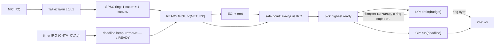

# ADR-0009: гибридный планировщик — таймер и события NIC

> [!abstract] Суть
> «Часть задач по таймеру, часть по событиям из NIC» реализуется не двумя планировщиками, а **одним**: у задач есть класс (event / periodic), у классов — разные источники пробуждения и разные правила вытеснения. NIC-IRQ только фиксирует событие (`READY |= NET_RX`, таймстамп, enqueue), а решение о переключении принимается в **safe point** — на выходе из IRQ или в явной точке блокировки. Внутри ISR контекст не переключаем. Data plane остаётся run-to-completion с бюджетом, как в [[0006_data_plane_async]]; таймер обслуживает дедлайны (одноразовый `CNTV_CVAL`), а не 1 кГц «на всякий случай».

## Контекст

Есть этап 5 ([[stage5_scheduler]]), таймер 4 Гц, один активный CPU, `SpinLock` ([[spinlock]]). Хочется, чтобы:
- обработка пакетов стартовала сразу по приходу кадра, а не «когда тикнет»;
- периодические задачи (ARP-таймеры, телеметрия, watchdog) имели предсказуемый запуск;
- idle не жёг CPU вхолостую.

Ограничения:
- на входе в IRQ `PSTATE.I = 1`, вложенности нет ([[irq_entry_exit]]);
- `println!` под общим `SpinLock`, heap тоже под замком;
- на RK3566 ожидается одна RX-очередь на порт ([[ethernet_queues_ptp]]), значит 1.49 Mpps на порт — IRQ на каждый кадр это ~1.5 млн исключений в секунду, слишком дорого;
- QEMU TCG не воспроизводит тайминги, проверяется только логика.

## Модель: четыре класса исполнителей

| Класс | Источник работы | Квант/бюджет | Может быть вытеснен | Где живёт |
|---|---|---|---|---|
| **ISR (top half)** | IRQ от NIC, таймера | нет | нет (`I=1`) | вектор → trampoline |
| **DP bottom half** | `NET_RX` | N пакетов или T µs | **нет** (только сам завершает) | цикл задачи |
| **CP periodic** | дедлайн таймера | — | да (учебный preemptive) | задача |
| **CP event** | конфиг, DHCP, mgmt | — | да | задача, `wait(events)` |
| **idle** | — | — | — | `wfi` |

Таймер и NIC здесь — **источники пробуждения**, а не два разных механизма переключения. Разница только в том, кто выставляет бит в `READY` и что задача с этим битом делает.

### Механика



Три инварианта:

1. **ISR не переключает контекст.** Он делает O(1): метка, запись в ring, `fetch_or`, EOI. Всё остальное — в задаче.
2. **Переключение только в safe point.** Их ровно два: выход из IRQ-trampoline (там уже сохранён полный кадр) и явная точка в задаче (`yield`, `wait`, конец бюджета). Посреди Rust-функции — никогда ([[context_switch]]).
3. **`READY` — атомарная битовая маска.** ISR пишет `fetch_or`, задача читает и сбрасывает биты, которые забрала. Это lock-free и не требует маскировать прерывания на каждое событие.

> [!warning] Почему не «переключение по событию внутри ISR»
> Технически можно подменить кадр прерванной задачи на IRQ-выходе. Но если DP-обработчик будет вытеснен посреди пакета, нарушится его же инвариант run-to-completion: незавершённое состояние (дескриптор, `SpinLock`) останется жить, а следующий заход в тот же код получит уже другой контекст. Плюс вытеснение под `SpinLock` — это priority inversion ([[stage5_scheduler]]). Событие должно **будить**, а не **вытеснять**.

## Таймер: дедлайны вместо периодического тика

- Сейчас `CNTV_TVAL = freq/4` — 4 Гц ([[arm_generic_timer]]). Для кванта это 250 мс, для таймаутов — грубо, а для idle — 4 лишних пробуждения в секунду.
- Правильнее: **одноразовый** таймер на **ближайший** дедлайн: `CNTV_CVAL_EL0 = now + (dl - now)`, при срабатывании — выдать готовые дедлайны и переставить `CVAL` на следующий. Дедлайны держать в маленькой куче/сортированном массиве (без аллокаций в ISR).
- Периодический тик нужен только тогда, когда есть preemptible-задачи и мы хотим квант. Тогда это отдельный режим: `CVAL = now + quantum`, и он включается/выключается.
- Побочный плюс: idle на пустом роутере спит до первого пакета или до ARP-таймаута, а не просыпается 4 раза в секунду.

## NIC: IRQ или polling

Три режима, выбираются по загрузке:

| Режим | Когда | Механика |
|---|---|---|
| IRQ | низкий pps | кадр → IRQ → `NET_RX` → DP |
| polling (бюджет) | высокий pps | DP крутится, IRQ не нужен |
| **NAPI-гибрид** (рекомендуется) | всё время | первый IRQ выключает RX-IRQ; DP выгребает до N пакетов; если пусто — RX-IRQ включается снова |

NAPI-гибрид решает обе крайности: на 1.49 Mpps нет 1.5 млн входов в исключение, а на простое CPU не крутится вхолостую. Бюджет подбирается по метрике p99 задержки и пропускной способности, а не «на глаз».

> [!warning] `wfi` и замаскированные прерывания
> Распространённое упрощение «`wfi` при замаскированных IRQ = вечный сон» неверно: `WFI` просыпается и при **pending** прерывании, даже если оно закрыто маской (именно на это опирается idle-путь Linux на arm64) — но обработчик не выполнится. Результат не «сон», а холостой цикл `wfi`, который немедленно возвращается. Отсюда правило: в idle входить с **включёнными** IRQ и после `wfi` перепроверять `READY`.
>
> Уточнение к формулировке в [[stage5_scheduler]] (файл не правил, там незакоммиченные изменения).

Ещё два факта про `wfi`, важных для событийной модели:
- `wfi` **не** просыпается от записи DMA в память или от изменения счётчика — только от прерываний/событий (`sev`/`wfe`). Значит «разбудить ядро по приходу пакета» можно только IRQ (или `sev` с другого ядра).
- `wfe`/`sev` полезны для межъядерных очередей ([[0007_core_partitioning]]), но не заменяют NIC-IRQ.

## API (предложение, не код)

```rust
// policy, host-testable
bits!(EventSet, NET_RX | NET_TX_DONE | TICK | CONFIG_CHANGED | SHUTDOWN);

pub fn spawn(task: fn(&mut TaskCtx), prio: Priority, class: Class) -> TaskId;
pub fn wait(&mut self, mask: EventSet) -> EventSet;   // Blocked + safe point
pub fn yield_now(&mut self);                          // safe point
pub fn wake_from_isr(id: TaskId, bits: EventSet);     // atomic OR, без локов
```

Правила для реализации:
- `wait` ставит задачу в `Blocked`, пишет маску ожидания, затем **перепроверяет** `READY` уже под маской IRQ — иначе классическая гонка «событие пришло между проверкой и сном».
- `wake_from_isr` — только атомики и, при необходимости, запись в фиксированный ring; никаких `lock()` и никакой аллокации.
- `Blocked`-задача не может держать `SpinLock` — иначе deadlock.
- Счётчики/гистограммы пишет только владелец; `println!` из DP/ISR запрещён ([[0006_data_plane_async]]).

## Как это соотносится с ADR-0006 и ADR-0007

- [[0006_data_plane_async]]: DP — run-to-completion с бюджетом. **Не меняется**: гибрид добавляет только то, *кто* будит DP (NIC-IRQ/`NET_RX`) и *кто* обслуживает дедлайны (таймер).
- [[0007_core_partitioning]]: ядро 0 — DP, ядро 1 — CP/executor. **Не меняется**: `READY`-маска и дедлайны — per-core, кросс-ядерные события идут через SPSC.
- Preemptive-переключение (этап 5.3) остаётся учебным упражнением и применяется **только к CP-задачам**. В путь пакета его не пускаем.

## Тесты

| Что | Где |
|---|---|
| `wait`/`wake` без гонки (событие до/после `wait`) | host, `fw-sched` |
| Приоритеты и голодание (бюджет DP не съедает CP) | host, модельное время |
| Дедлайны: порядок, переустановка `CVAL`, пустая очередь | host + QEMU |
| NAPI-цикл: IRQ off → drain → IRQ on | QEMU (функционально) |
| p99 wakeup → first packet, pps, стоимость ISR | только плата, счётчиком циклов `CNTPCT_EL0` |

## Последствия

- + задержка реакции на пакет определяется IRQ, а не периодом тика;
- + нет 1.5 млн исключений в секунду при line-rate;
- + idle спит до события; таймер не тикает зря;
- − нужны `READY`-маска, механика `Blocked`, safe points — это и есть ядро этапа 5;
- − бюджет DP надо подбирать и мерить;
- − на QEMU TCG тайминги не проверяются, только логика ([[latency_measurement]]).

## Принятые решения (2026-10)

1. **Порядок этапа 5:** 5.1 cooperative → 5.2 idle/exit → 5.3 events → 5.4 deadlines. Preemptive (5.5) — **опциональное упражнение** после рабочего событийного планировщика (вариант 3B). План — [[roadmap_5_12]].
2. **Следствие 3B:** таймер **не вытесняет** задачу. Дедлайн будит задачу, но CPU она получит только в безопасной точке текущей задачи (`wait`, `yield`, конец бюджета) или через idle. Для DP это штатно (бюджет = safe point), для CP — риск зависшей задачи; принимаем осознанно.
3. **Источник событий до этапа 6:** таймер-IRQ как заглушка NIC: `wake_from_isr(dp, TICK)`. На этапе 6 меняется одна строка на `NET_RX`.
4. **Событие не теряется:** у задачи есть `PENDING`-маска (атомарная, per-task), `wait` проверяет её до и после перехода в `Blocked`.

## Открытые вопросы

> [!question]
> - Какой бюджет DP: 8/16/32 пакета или время (например, 50 µs)?
> - Нужен ли квант CP-задачам вообще, если все они кооперативные и короткие?
> - Целевой pps для настройки NAPI: домашний роутер (1–5 kpps) или near line-rate?

## Источники
- ARM ARM (DDI 0487): `WFI`/`WFE`, wake-up events; `CNTV_CVAL_EL0`, `CNTV_CTL_EL1`.
- Linux arm64 `cpu_do_idle` — idle-путь с маской и `wfi`.
- DWMAC TRM: interrupt moderation / NAPI-модель в `stmmac`.

## Связанные заметки
- [[0006_data_plane_async]], [[0007_core_partitioning]], [[stage5_scheduler]], [[task_and_scheduler]], [[context_switch]], [[irq_entry_exit]], [[arm_generic_timer]], [[spinlock]], [[latency_measurement]], [[0008_workspace_layout]]
