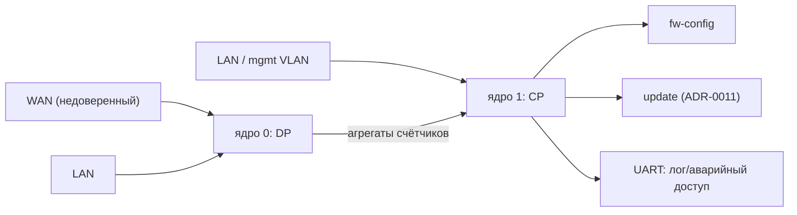

# ADR-0010: веб-интерфейс и management plane

> [!abstract] Суть
> Управление — отдельная **плоскость**, а не часть data plane: свой интерфейс/VLAN, свой CPU-контекст (CP), низкий приоритет относительно пакетов и жёсткое правило «management недоступен с WAN». Сервер — минимальный HTTP/1.1 на `smoltcp`, статика вшита в образ (`include_bytes!`), API — JSON. TLS в первой версии не делаем: вместо него отдельный management-сегмент, Digest-аутентификация без дефолтного пароля и явный threat model. Закладывается структура сейчас, реализуется после этапа 9.

## Контекст

Нужно с браузера: смотреть статус, править правила, обновлять прошивку. Ограничения проекта:

- нет ОС, нет файловой системы, нет динамической загрузки кода — UI обязан быть вшит в образ;
- `smoltcp` даёт TCP-сокеты, но не HTTP-сервер ([[0008_workspace_layout]]);
- heap — bump без освобождения, поэтому в обработчике запроса аллокации быть не должно;
- единственный «богатый» ресурс — RAM (1 ГБ), но её нельзя тратить на буферизацию запросов;
- `println!` идёт через общий `SpinLock`, UART медленный;
- правил безопасности на устройстве ещё нет, а веб-морда — самый вероятный вход.

## Решение по плоскостям



- **Отдельный адрес/VLAN** для управления. Если один физический порт — management только на LAN-стороне, отдельный VLAN, и явный drop на WAN-интерфейсе.
- **Никогда не слушать HTTP на WAN-порту.** Это правило должно быть в дефолтном конфиге, а не «настраиваемым».
- **Никакого `println!` из обработчика запросов**: логи — в ring buffer, выводит отдельная CP-задача.

## HTTP-сервер: бюджет и устройство

| Решение | Почему |
|---|---|
| HTTP/1.1, **одно соединение** за раз | роутер администрируется одним человеком; очередь соединений — лишний код и память |
| `Connection: close` для API | не нужен keep-alive state machine и таймауты простоя |
| Лимиты: 8 КБ заголовки, 32 поля, тело ≤ 64 КБ (кроме upload) | защита от переполнения буфера и от медленных атак |
| Таймаут чтения запроса | иначе одно соединение блокирует сервер навсегда |
| Статика — `include_bytes!`, заранее сжатая | нет ФС, нет парсера gzip на устройстве (отдаём `Content-Encoding: gzip`) |
| Без шаблонизатора и без CDN | UI работает офлайн; не тянем JS-фреймворк |
| Один статический буфер на запрос/ответ | bump-аллокатор не умеет освобождать |

Ориентир по размеру UI: 30–80 КБ gzip — это нормально для встроенного образа; собирать фронтенд на хосте в `build.rs` (или коммитить готовый бандл).

## API (эскиз)

```text
GET    /api/v1/status         uptime, link state, pps, counters, conntrack size, version
GET    /api/v1/config         текущий конфиг + schema_version
PUT    /api/v1/config         полная замена (с валидацией + атомарной записью)
GET    /api/v1/rules          список правил
POST   /api/v1/rules          добавить (id выдаёт устройство)
PATCH  /api/v1/rules/{id}     изменить
DELETE /api/v1/rules/{id}     удалить
GET    /api/v1/logs?since=…   ring buffer, курсор
POST   /api/v1/firmware       upload → staging slot (ADR-0011)
POST   /api/v1/reboot         только с подтверждением
```

Правила API:
- идемпотентные `PUT` для конфига, `PATCH` — для полей правила;
- **валидация целиком до применения**: невалидный конфиг не должен оставить устройство в полурабочем состоянии;
- ответы `application/json`, ошибки — `{ "error": "...", "code": ... }`, без внутренних адресов/паник;
- `schema_version` в конфиге — задел на миграции ([[0011_update_and_slots]]).

## Аутентификация и безопасность

Реалистичный минимум без TLS:

| Механизм | Зачем | Цена |
|---|---|---|
| **HTTP Digest (RFC 7616)** | пароль не идёт открытым текстом | нужен nonce/realm, md5/sha256 |
| **Пароль только хешем** (SHA-256 + соль, лучше PBKDF2) | компрометация образа не даёт пароль | `argon2` в `no_std` тяжёл, PBKDF2 проще |
| **Нет дефолтного пароля** | иначе устройства с одинаковым паролем = ботнет | пароль генерируется при первом старте и печатается в UART, пока не задан свой |
| **Проверка `Host`/`Origin`** | DNS rebinding и CSRF | простые проверки |
| **CSRF-токен + `SameSite=Strict`** | состояние меняется только из UI | cookie-сессия |
| **Rate limit на логин** (например, 5 попыток / 60 с) | перебор | счётчик в RAM |
| **`Content-Security-Policy: default-src 'self'`** | XSS | одна строка заголовка |
| **Ограничение источников для `/api`** | не отвечать на запросы с WAN | проверка интерфейса, а не только IP |

> [!warning] Что HTTP без TLS не защищает
> Трафик читается в management-сегменте: правила файрвола, логи и **сам пароль при Basic** (поэтому Digest, не Basic). Digest не защищает от MITM-подмены ответа. Для домашнего роутера это приемлемо при изолированном management-сегменте; если нужен TLS — это отдельное решение (`embedded-tls` + аппаратный crypto-движок RK3566, значительный объём работы).

> [!warning] Самый опасный эндпоинт — `POST /firmware`
> Загрузка образа обязана требовать: аутентификацию, явное подтверждение в UI, проверку длины и **проверку подписи/хеша до записи во флеш** ([[0011_update_and_slots]]). Нельзя принимать образ «как есть» и перезагружаться.

## Что заложить сейчас, а что делать на этапе 11

Сейчас (этапы 5–9), без HTTP:

1. `fw-config`: модель конфига как данные (`serde`-совместимая структура или ручная сериализация) + `schema_version` + валидатор. Это ядро и для UI, и для обновлений, и для тестов на хосте.
2. Счётчики и статус — уже структурированные (`struct Counters`), а не только `println!`. UI потом просто сериализует их.
3. Management-интерфейс как абстракция: `trait ManagementTransport` / отдельный «порт», чтобы HTTP не протёк в data plane.
4. Правило в архитектуре: management-трафик не обрабатывается DP-циклом.

Этап 11: `fw-mgmt` (HTTP + API), статика, аутентификация.

## Варианты

| Вариант | Плюсы | Минусы |
|---|---|---|
| **A. HTTP + JSON API + вшитая статика (рекомендуется)** | браузер из коробки, минимум кода, тестируется curl'ом | нет TLS, свой парсер |
| B. HTTP + server-side HTML без JS | ещё меньше кода | неудобно для таблицы правил |
| C. Только CLI по UART/SSH | легче и безопаснее | пользователь просил браузер; SSH — свой стек |
| D. TLS сразу (`embedded-tls`) | защищённый канал | +RAM/время, нужен crypto-движок и отладка TLS |

## Последствия

- + управление изолировано от горячего пути;
- + конфиг становится данными → тестируется на хосте;
- + API — единственная точка изменения состояния, удобно логировать;
- − нужен свой HTTP-парсер с лимитами (это не «пять строк»);
- − аутентификация без TLS требует дисциплины по сегментации;
- − статику надо собирать на хосте и обновлять вместе с образом.

## Принятое решение (2026-10)

**Management — VLAN на LAN-порту (вариант 4A).** Второй физический порт остаётся WAN и management-трафик не обслуживает. Это важно для этапов 6–9: дефолтный конфиг обязан содержать drop для management-порта на WAN-интерфейсе, а `fw-mgmt` не должен даже слушать сокет на WAN.

## Открытые вопросы

> [!question]
> - Нужен ли TLS в первой версии, или management-сегмент считается доверенным?
> - Сколько администраторов: один или роли (read-only / admin)?
> - UI на русском, английском или оба (i18n в статике)?
> - Нужны ли графики (история) или достаточно текущих счётчиков? История = хранение во флеш/RAM-кольце.

## Источники
- RFC 9110 (HTTP semantics), RFC 7616 (Digest), RFC 6265 (cookies).
- OWASP: CSRF, DNS rebinding, CSP.
- `smoltcp` examples (TCP-сокеты, HTTP-сервер как пример).

## Связанные заметки
- [[0007_core_partitioning]], [[0011_update_and_slots]], [[0008_workspace_layout]], [[0006_data_plane_async]]
