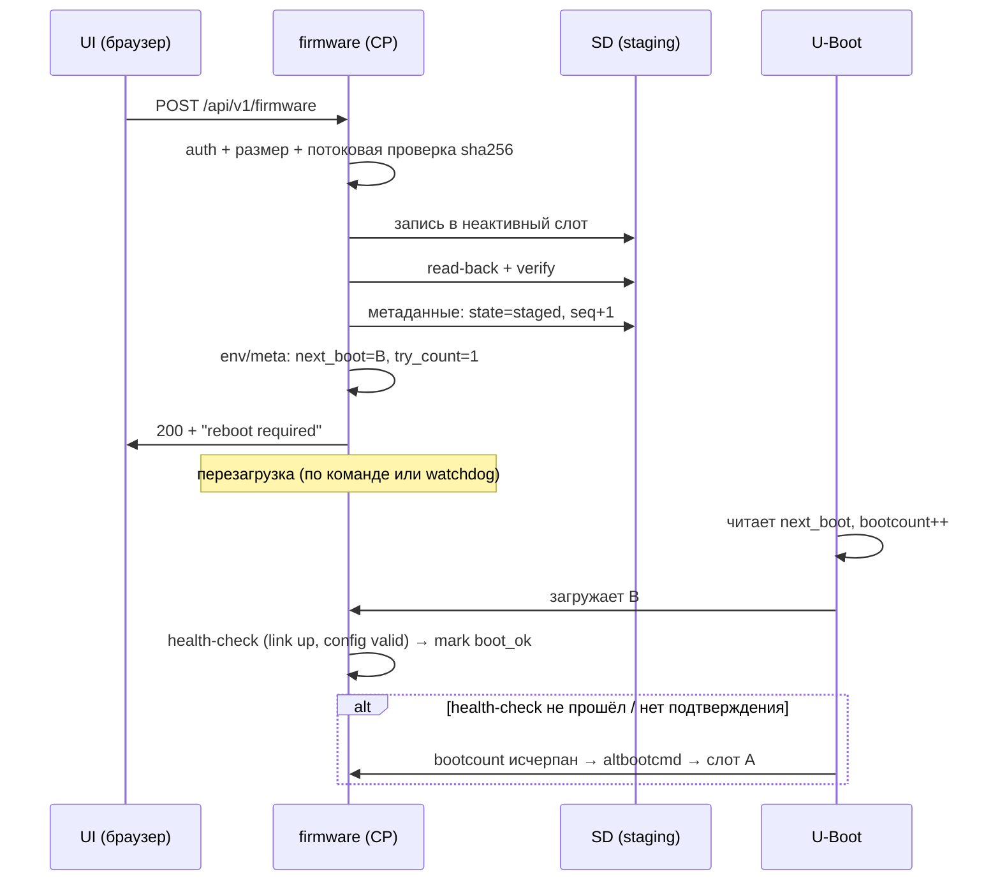

# ADR-0011: система обновления и постоянное хранилище

> [!abstract] Суть
> Обновление делим на два независимых механизма: **образ** (A/B-слоты, выбор слота и откат — на стороне U-Boot) и **конфиг** (две копии с CRC и номером версии). Главный принцип: **не писать поверх работающего образа** и **не реализовывать в своей прошивке то, что уже умеет загрузчик** — USB-хост, FAT и TFTP есть в U-Boot. Браузерная загрузка — самый поздний и самый дорогой путь: ей нужен драйвер SD и запись в staging. Формат: зафиксировать сейчас, реализовывать после этапа 10.

## Контекст

- У платы **нет eMMC**, единственный носитель — SD-карта; её можно вынуть и перепрошить на ПК ([[0004_baremetal_vs_linux]]).
- Сейчас образ грузится как raw `.bin` по `tftp 0x42000000` + `go` ([[uboot_loading]]), адрес совпадает с базой линковки ([[load_address]]).
- SDMMC в RK3566 — контроллер семейства DesignWare (`dw_mmc`), **не SDHCI**: свой драйвер — это не «пара регистров», проверить по TRM.
- U-Boot умеет TFTP, USB-хост, FAT/ext4, проверку образов, `bootcount`/`altbootcmd`.
- В прошивке нет ни ФС, ни TLS, ни часов реального времени (есть только монотонный `CNTVCT`).
- `#![no_std]`, bump-аллокатор, паника = стоп.

Из этого следует главное решение: **разделить «кто обновляет»**. Пока мы в dev-режиме — обновляет U-Boot по TFTP. Позже, когда появится сеть и UI, прошивка сможет только *положить* образ в staging и попросить перезагрузку.

## Три канала обновления

| Канал | Кто исполняет | Что нужно написать нам | Когда |
|---|---|---|---|
| **TFTP** | U-Boot | ничего (уже работает) | сейчас |
| **USB-флешка** | U-Boot (`usb start; fatload …`) | ничего | этап 10 |
| **Браузер** | наша прошивка → staging → reboot → U-Boot | SD-драйвер + HTTP upload | этап 12 |

### Почему USB — через U-Boot, а не через свою прошивку

Свой USB-хост (xHCI) + mass storage + FAT в `no_std` — это месяцы и постоянный источник багов. U-Boot уже содержит всё это и умеет `fatload usb 0:1 0x42000000 fw.bin`. Единственное, что нужно от нас, — сценарий обновления в U-Boot (env-переменные/скрипт) и, при желании, флаг «обновиться при следующей загрузке», который прошивка пишет в конфиг/staging.

### Почему браузерная загрузка — самая дорогая

Чтобы принять файл и не потерять его при выключении, нужно:
1. HTTP upload с лимитом размера и потоковой записью (не в RAM целиком);
2. драйвер SDMMC (block read/write) и запись в **неактивный** слот;
3. чтение обратно и проверка хеша/подписи;
4. установка флага «следующая загрузка — слот B»;
5. ребут в U-Boot, который этот флаг прочитает.

Пункты 1–3 — основная работа. Пункт 4–5 требуют согласованной схемы метаданных.

## Схема слотов

```text
SD card (или сервер TFTP, если грузимся по сети)
┌────────────┬────────────────────────────────────────────┐
│ p1         │ U-Boot + его env (bootcount, boot_slot)    │
├────────────┼────────────────────────────────────────────┤
│ p2 (A)     │ firmware A                                 │
├────────────┼────────────────────────────────────────────┤
│ p3 (B)     │ firmware B (staging / previous)            │
├────────────┼────────────────────────────────────────────┤
│ p4 (data)  │ config A | config B | метаданные образов   │
└────────────┴────────────────────────────────────────────┘
```

Метаданные одного слота (фиксированный блок, две копии):

| Поле | Зачем |
|---|---|
| `magic`, `format_version` | опознать и не читать мусор |
| `image_version` | SemVer, показывается в UI |
| `offset`, `length` | где лежит образ |
| `sha256` | целостность при чтении/после записи |
| `signature` (опционально) | подлинность (см. ниже) |
| `state` | `empty` / `staged` / `active` / `bad` |
| `seq` | какая из двух копий метаданных свежее |
| `crc32` | целостность самих метаданных |

### Процедура обновления



Три обязательных свойства:
1. **Активный слот не перезаписывается никогда** — иначе нет отката.
2. **Подтверждение здоровья** новой прошивки (например, 30 с без паники и с поднятым линком) — иначе U-Boot по `bootcount` вернётся на старый слот.
3. **Атомарность метаданных**: пишем вторую копию, потом инкрементим `seq`; читаем ту, у которой `seq` больше и CRC сходится.

## Конфиг: две копии, CRC, версия схемы

- Хранить не в файловой системе, а в **сыром регионе** с двумя копиями: запись всегда в «старую» копию, затем `seq+1`, затем чтение-проверка.
- Поля: `magic`, `schema_version`, `seq`, `payload_len`, `crc32`, payload (бинарный формат или TOML — что проще разбирать на хосте и в `no_std`).
- **Заводские дефолты — в образе** (`include_bytes!`), чтобы плата поднялась с пустой/битой SD.
- Миграция: `schema_version` < текущей → мигратор; > текущей → refuse (прошивка старее конфига).
- Счётчики/статистику в конфиг **не писать** (износ и потеря при отключении питания); они живут в RAM.

> [!warning] SD-карта — не eMMC
> У карт есть внутренний FTL и износ, но **нет гарантии атомарности записи** при отключении питания: блок может быть записан частично. Отсюда две копии + CRC + `seq`. И отдельно: карту можно вынуть — устройство обязано стартовать с дефолтами, а не с паникой.

## Целостность и подлинность

| Что | Даёт | Замечание |
|---|---|---|
| SHA-256 | обнаружение порчи/обрыва загрузки | встроить в метаданные, сверять после записи и перед загрузкой |
| Подпись Ed25519 | подлинность образа | приватный ключ **никогда** не на устройстве; в образе только публичный |
| Anti-rollback (`min_version`) | защита от отката на уязвимую версию | требует доверенного хранения порога |

> [!warning] Без secure boot подпись не панацея
> Если у U-Boot нет проверки подписи (а по умолчанию её нет), злоумышленник с физическим доступом может загрузить что угодно через `go`. Подпись в нашей прошивке защищает от подмены **образа в канале обновления**, а не от физического доступа. Проверку надо ставить и в U-Boot (`FIT` + public key), иначе цепочка доверия начинается с незащищённого звена.
>
> Для `no_std` брать проверенные реализации (`ed25519-dalek` с `alloc` или компактный верификатор) и **проверять сборку под `aarch64-unknown-none`** — не все крейты собираются без `std`.

## Формат образа и текущий `go`

Сейчас `go 0x42000000` требует, чтобы `.bin` начинался ровно с `_start` ([[uboot_loading]]). Как только появляется заголовок (magic/версия/длина/hash), первые байты — уже не код:
- либо **отдельный** заголовок в метаданных, а образ остаётся raw (проще, ничего не ломаем);
- либо переход на ELF + `bootelf` (U-Boot разложит сегменты сам);
- либо FIT (`bootm`), если хотим подпись и метаданные в одном файле — тогда надо освоить `mkimage`.

Рекомендация для учебного проекта: **метаданные отдельно, образ raw** — минимальные изменения к текущему сценарию.

## Этапы

| Этап | Что делаем |
|---|---|
| 5–9 | ничего не менять: TFTP + `go`; ввести `image_version` строкой в прошивке |
| 10 | сценарий U-Boot: `bootcount`/`altbootcmd`, выбор слота из env; обновление по USB и TFTP через `fatload`/`tftp` |
| 11 | `POST /api/v1/firmware` в staging: SD-драйвер, потоковая запись, verify |
| 12 | подтверждение здоровья, авто-откат, подпись/anti-rollback, тесты на обрыв питания |

## Тесты

| Что | Как |
|---|---|
| Обрыв питания посреди записи | стенд с реле/удержанием reset; после — устройство обязано подняться |
| Битая CRC / половина метаданных | подменить блок в образе SD, проверить выбор копии |
| Невалидный образ (не тот размер/хеш) | upload → отказ без записи в активный слот |
| Откат по `bootcount` | прошивка B, которая «зависает» до подтверждения |
| Понижение версии | `min_version` отклоняет |
| Пустая SD | старт с дефолтами |

## Варианты

| Вариант | Плюсы | Минусы |
|---|---|---|
| **A. U-Boot обновляет, прошивка только просит (рекомендуется)** | минимум кода, зрелые драйверы | нужен env-сценарий; UI только «положил и ребутнул» |
| B. Своя прошивка пишет SD | один сценарий, без U-Boot env | драйвер SD, риск окирпичивания |
| C. Только TFTP, без слотов | уже работает | нет отката, нет «в поле» |
| D. Сразу USB+FAT в прошивке | независимость от загрузчика | несоразмерно трудоёмко |

## Последствия

- + откат и защита от «кирпича» заложены архитектурно, а не прикручены потом;
- + конфиг и образ обновляются независимо;
- + USB/флешка не требуют своего USB-стека;
- − нужен драйвер SD для браузерного пути (самая дорогая часть);
- − без secure boot в U-Boot доверие ограничено физическим доступом;
- − нужен стенд с обрывом питания, иначе «атомарность» остаётся на бумаге.

## Открытые вопросы

> [!question]
> - Есть ли на NanoPi R3S LTS SPI NOR (U-Boot/env) или env живёт на SD? Проверить: `sf probe` в U-Boot, `/proc/mtd` в вендорском Linux.
> - SDMMC в RK3566 — точно `dw_mmc`? Сколько регистров на инициализацию, есть ли DMA (IDMAC)?
> - Нужна ли подпись образов и anti-rollback, или достаточно SHA-256?
> - Где хранить «подтверждение здоровья»: env U-Boot или наш блок метаданных?
> - Обновление «в поле» по Wi-Fi/интернету вообще нужно, или только локально (TFTP/USB/LAN)?

## Источники
- U-Boot: `bootcount`/`altbootcmd`, `CONFIG_BOOTCOUNT_LIMIT`, `fatload`, `bootelf`, FIT/`mkimage`.
- RK3566 TRM: SDMMC (DesignWare `dw_mmc`), SPI NOR.
- RFC 6234 (SHA-256), RFC 8032 (Ed25519).

## Связанные заметки
- [[uboot_loading]], [[load_address]], [[0004_baremetal_vs_linux]], [[0010_management_http]], [[0008_workspace_layout]], [[0009_hybrid_scheduling]]
