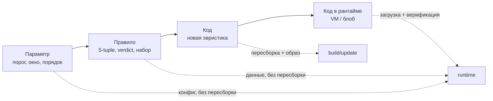

# ADR-0012: как подключать новые алгоритмы защиты

> [!abstract] Суть
> Запланированный каркас ([[roadmap_5_12]], этап 8.5) — трейты `Egress/Ingress/Connection` + **реестр фиксированного размера без аллокаций**; этого достаточно, чтобы *включать и параметризовать* уже собранные алгоритмы из конфига. Для **нового кода** «без пересборки» есть три принципиально разных уровня: (1) локальная сборка — только изменённый крейт (workspace); (2) доставка — новый образ через A/B-слот ([[0011_update_and_slots]]); (3) исполнение недоверенного кода в рантайме — байткод-VM/интерпретатор (дорого) или нативный блоб (нет изоляции, только подпись). Рекомендация: 8.5 — реестр + конфиг, 9 — правила как данные, 9.5 — стратегии как `enum` + параметры; VM/блоб — только при явной потребности «залить алгоритм из UI».

## Контекст: что уже запланировано

- Этап 8.5: `fw-modules` — трейты хуков и реестр на фиксированный `MAX_MODULES`, тест «порядок вызова хуков» на хосте.
- Этап 9: `fw-firewall` (правила, conntrack, NAT) и `fw-config` (`schema_version`, валидация) — вся логика чистая, host-тестируемая.
- Этап 9.5: DPI-стратегии `split`/`fake`/`badseq`, профили, хостлисты.
- Data plane — run-to-completion с бюджетом: в хуках нельзя аллоцировать, долго держать `SpinLock`, печатать ([[0006_data_plane_async]], [[0009_hybrid_scheduling]]).
- Конфиг и образ обновляются независимо; слоты A/B дают откат ([[0011_update_and_slots]]).
- `panic = "abort"` и нет изоляции адресных пространств: упавший код роняет весь файрвол.

## Три уровня «новизны»



Практический вывод: **большинство «новых алгоритмов» — это новые правила и параметры**, а не новый код. Поэтому сначала выжимается уровень «данные», и только потом платится за динамический код.

## Варианты

| # | Вариант | Что нового без пересборки | Пересборка образа | Плюсы | Минусы |
|:--:|---|---|---|---|---|
| A | Cargo features | выбор набора алгоритмов при сборке | полная, на каждую комбинацию | нулевая runtime-цена, мёртвый код вырезается | features **аддитивны** и объединяются по графу ([[0008_workspace_layout]]); 2^N конфигураций; `cfg`-каша |
| B | Крейт на алгоритм + workspace | ничего, но собирается только изменённое | только этот крейт + relink | изоляция, host-тесты, границы «политика/механизм» ([[0008_workspace_layout]]) | всё равно reflash + reboot; секунды, не минуты — это оптимизация dev-цикла, не доставки |
| C | Реестр + конфиг: enable / order / params | комбинация и настройка готовых алгоритмов | **нет** | ноль кода, hot-apply, безопасно, валидируется `fw-config`; ложится на [[0011_update_and_slots]] | новый код всё равно нужен; образ растёт со всеми алгоритмами |
| D | Правила как данные (ruleset/таблица) | новые политики фильтрации | **нет** | таблица = дешёвый матчинг; golden-тесты на хосте; без риска паники | выразительность ограничена моделью правил; DPI-эвристики не выразить |
| E | Байткод-VM + верификатор (eBPF-подобный) | программа-алгоритм | **нет**, загрузка по сети | верификатор + бюджет инструкций → завершаемость и границы памяти; сбой программы не роняет DP; host-тесты | интерпретатор в горячем пути медленный; свой компилятор + верификатор — большой проект; без JIT побайтовый DPI не тянет |
| F | WASM-интерпретатор (`wasmi` и др.) | wasm-модуль | **нет** | готовый тулчейн, sandbox, memory safety | тяжёлый крейт, скорость интерпретатора, `no_std`-сборку проверять, RAM/стек |
| G | Нативный PIC-блоб + свой загрузчик | любой Rust/C-код | **нет** | полная скорость, нет ограничений языка | свой линкер/релокации, только `extern "C"` + `#[repr(C)]` (Rust ABI нестабилен), сброс D-/I-кэша, **нет изоляции**: модуль работает на EL1 и падение = падение файрвола; подпись обязательна |
| H | A/B-образ + подпись ([[0011_update_and_slots]]) | новая прошивка | на хосте, не на устройстве | откат, целостность, ничего нового писать не надо | reboot, полный образ, это «новая версия», а не hot-plug |

### Оценка по критериям пути пакета

| Вариант | Скорость в DP | Безопасность/изоляция | Трудоёмкость | Когда применять |
|---|---|---|---|---|
| A features | ★★★ | ★★★ (кода нет) | низкая | никогда как способ доставки |
| B крейты | ★★★ | ★★★ | низкая | всегда, как гигиена сборки |
| C конфиг | ★★★ | ★★★ | средняя (валидация) | этап 8.5–9, по умолчанию |
| D правила | ★★★ | ★★★ | средняя | этап 9 |
| E VM | ★ (интерпретатор) | ★★ (верификатор) | очень высокая | только если нужен загружаемый код |
| F WASM | ★ | ★★★ | высокая | если нужен чужой тулчейн |
| G блоб | ★★★ | ☆ (доверие на слово) | высокая | учебный эксперимент |
| H A/B | ★★★ | ★★★ | уже запланировано | доставка нового кода |

## Рекомендация

1. **8.5 — B + C.** Трейты и реестр фиксированного размера; выбор/порядок/параметры — из конфига. Алгоритмы — отдельными крейтами, регистрация — явным списком в `firmware` (не `linkme`-секции: порядок и дубликаты плохо ловятся).
2. **9 — D.** Правила фильтрации — данные, а не код: `fw-firewall` + `fw-config` уже это предполагают.
3. **9.5 — C.** `split`/`fake`/`badseq` — `enum` + параметры (TTL, размер сегмента, число повторов, окно). Это покрывает почти все «новые стратегии» без пересборки.
4. **E — только при явном требовании** «залить алгоритм из UI/по сети». И начинать с **connection-level** (первые N пакетов потока), а не с побайтового DPI: там интерпретатор ещё укладывается в бюджет.
5. **G — не в основной ветке.** Недоверенный нативный код без EL0/MMU-изоляции — это удалённое исполнение произвольного кода. Если делать, то как учебное упражнение после этапа 10, с подписью Ed25519 и отдельным слотом.
6. **H — единственный поддерживаемый путь доставки нового кода**; всё остальное — либо данные, либо эксперимент.

## Что заложить в интерфейс уже сейчас (8.5)

Ключевое: контракт хука должен быть пригоден и для статического, и для VM-варианта — тогда переход не потребует переписывать ядро.

```rust
pub const MAX_MODULES: usize = 8;

#[derive(Clone, Copy, PartialEq, Eq)]
pub enum Verdict { Continue, Drop, Stolen }

pub struct PktMeta {
    pub ingress: bool,
    pub l3: u8,
    pub l4: u8,
    pub ts_cycles: u64,
}

pub trait EgressModule: Sync {
    fn name(&self) -> &'static str;
    /// Кадр — срез буфера; владение не передаётся, meta отдельно от байтов.
    fn hook(&self, frame: &mut [u8], meta: &mut PktMeta) -> Verdict;
}

// порядок = порядок вызова; заполняется на boot, дальше только чтение
static MODULES: SpinLock<[Option<&'static dyn EgressModule>; MAX_MODULES]> = ...;
```

Правила дизайна, которые дешево заложить и дорого добавлять потом:

- хуки возвращают `Verdict`, а не паникуют и не аллоцируют;
- у каждого модуля — бюджет (пакеты/такты) и счётчики; превышение = `Drop`/скип, а не зависание DP;
- `PktMeta` отдельно от `frame` — понадобится для таймстампа ([[0006_data_plane_async]]) и для VM-контекста;
- регистрация — один явный список в `firmware`; конфиг ссылается на модули по стабильному id (`u16`), а не по индексу в массиве;
- конфиг валидируется целиком до применения: неизвестный id, дубль, переполнение `MAX_MODULES` → отказ конфига, не паника.

> [!warning] Чего нельзя делать
> - **Интерпретатор в побайтовом DPI.** На 1.5 Mpps × 1500 байт никакой интерпретатор не уложится; бюджет есть только у connection-level эвристик.
> - **`panic = "abort"` + нативный модуль.** `catch_unwind` невозможен: любая ошибка загруженного кода — это паника всего устройства. Изоляция требует запуска на EL0, то есть своего микроядра.
> - **Загрузка кода без подписи.** Сеть + «залить блоб» = готовый backdoor; Ed25519 и anti-rollback из [[0011_update_and_slots]] обязательны.
> - **`cargo features` как способ выбрать «один из N».** В workspace features унифицируются: включённые в одном месте включатся везде ([[0008_workspace_layout]]).
> - **Забыть про I-кэш при нативном блобе.** После записи кода: clean D-кэш до PoU → `DSB ISH` → `IC IALLU` → `DSB ISH` → `ISB`, иначе executes старый мусор.

## Открытые вопросы

> [!question]
> - Что именно означает «без перекомпилирования»: сократить dev-цикл (тогда B) или обновлять устройство в поле (тогда C/D/H)?
> - Нужен ли вообще запуск **чужого** кода, или достаточно «наших модулей, включаемых конфигом»?
> - Если VM: какие операции разрешить (чтение/запись кадра, счётчики, drop) и какой бюджет инструкций на пакет?
> - Где хранить параметры модуля: в общем конфиге или отдельным блоком с своим `schema_version`?

## Источники
- [[roadmap_5_12]] (этап 8.5), [[0008_workspace_layout]], [[0009_hybrid_scheduling]], [[0011_update_and_slots]].
- eBPF: верификатор, бюджеты, `BPF_PROG_LOAD`; Linux `Documentation/bpf`.
- ARM ARM (DDI 0487): кэш-обслуживание (`DC CVAU`, `IC IALLU`), права доступа блоков (AP/UXN/PXN).
- Rust Reference: отсутствие стабильного ABI, `extern "C"`, `#[repr(C)]`.

## Связанные заметки
- [[roadmap_5_12]], [[0006_data_plane_async]], [[0008_workspace_layout]], [[0009_hybrid_scheduling]], [[0011_update_and_slots]], [[mmu_basics]], [[a64_descriptors]], [[latency_measurement]]
