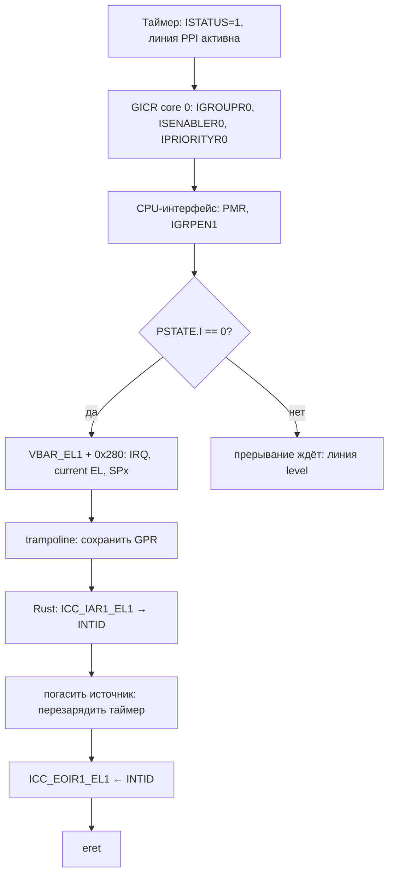

# GICv3: дистрибьютор, редистрибьютор, CPU-интерфейс

> [!abstract] Суть
> GICv3 — контроллер прерываний из трёх частей: **GICD** (общие SPI и маршрутизация), **GICR** (per-CPU: SGI/PPI) и **CPU-интерфейс** (системные регистры `ICC_*`). Прерывание дойдёт до ядра только при трёх открытых «вентилях»: линия устройства активна, INTID разрешён в GIC и проходит по приоритету, а `PSTATE.I/F` не маскирует класс.

## Путь прерывания



## Кто за что отвечает

| Блок | Регион QEMU virt | Что обслуживает |
|---|---|---|
| GICD (distributor) | `0x0800_0000` | SPI (INTID ≥ 32), глобальные enable, маршрутизация по affinity |
| GICR (redistributor) | `0x080A_0000` + `0x2_0000 × core` | SGI (0–15), PPI (16–31) своего ядра, LPI |
| CPU-интерфейс | системные регистры `ICC_*` | маска приоритета, ack, EOI, enable групп |

У каждого GICR два 64-КБ кадра: **RD_base** (`+0x0`) и **SGI_base** (`+0x1_0000`). `WAKER` и `TYPER` — в RD_base, управление SGI/PPI — в SGI_base.

## INTID: кто есть кто

| Диапазон | Тип | Где настраивается |
|---|---|---|
| 0–15 | SGI (межъядерные) | GICR SGI_base |
| 16–31 | PPI (private peripheral) | GICR SGI_base |
| 32–1019 | SPI (shared peripheral) | GICD |
| 1023 | spurious | — |

Таймер — это **PPI**, поэтому его биты живут в редистрибьюторе своего ядра, а не в GICD. Для QEMU `-smp 4` ядро 0 — `0x080A_0000`, ядро 1 — `0x080C_0000` и т.д. (шаг кадра `0x2_0000`).

Раскладка PPI ARM-таймера (номер PPI + 16 = INTID):

| Таймер | INTID |
|---|---|
| hypervisor (EL2) | 26 |
| virtual (EL1) | 27 |
| secure physical (EL1) | 29 |
| non-secure physical (EL1) | 30 |

## Группы и DAIF

- `IGROUPR0`/`IGROUPR<n>`: значение бита n определяет группу: `0` — Group 0, `1` — Group 1.
- Group 0 и Group 1 Secure приходят как **FIQ**, Group 1 Non-secure — как **IRQ**.
- В QEMU virt обычно `DS=1` (single security state): Group 1 → IRQ.
- `DAIF`: `I` (бит 7 PSTATE) маскирует IRQ, `F` (бит 6) — FIQ. `msr daifclr, #2` снимает маску IRQ; `msr daifset, #2` — ставит.
- На входе в исключение CPU сам ставит `PSTATE.I=1`, поэтому обработчик не прерывается сам собой (вложенность выключена).

> [!warning] Если IGROUPR не выставлен
> Прерывание уйдёт как FIQ в слот `0x300`. Там у нас `unexpected` → печать и вечный цикл. Симптом: «IRQ не приходит, но напечаталось Unexpected exception».

## Приоритет

- Приоритет 8-битный: **меньше число — выше приоритет**.
- `ICC_PMR_EL1` — порог: проходят прерывания со строго меньшим числом, чем PMR. `PMR=0xFF` пропускает всё, кроме приоритета `0xFF`.
- `GICR_IPRIORITYR` — по байту на INTID: адрес `SGI_base + 0x400 + INTID`.
- Для таймера достаточно `0xA0`, PMR `0xFF`.

## Константы вместо магии

Имена лучше повторяют ARM/Linux: префикс блока (`GICD_`, `GICR_`, `ICC_`), затем регистр, затем поле. Адреса регистров — `usize`, битовые маски — `u32`/`u64`.

```rust
// ---- GICD ----
const GICD_BASE: usize = 0x0800_0000;
const GICD_CTLR: usize = GICD_BASE + 0x0000;
const GICD_CTLR_ENABLE_GRP1: u32 = 1 << 1;
const GICD_CTLR_ARE: u32 = 1 << 4;
const GICD_CTLR_RWP: u32 = 1 << 31;

// ---- GICR ----
const GICR_RD_BASE: usize = GICD_BASE + 0xA_0000;
const GICR_SGI_BASE: usize = GICR_RD_BASE + 0x1_0000;

const GICR_WAKER: usize = GICR_RD_BASE + 0x0014;
const GICR_WAKER_PROCESSOR_SLEEP: u32 = 1 << 1;
const GICR_WAKER_CHILDREN_ASLEEP: u32 = 1 << 2;

const GICR_IGROUPR0: usize = GICR_SGI_BASE + 0x0080;
const GICR_ISENABLER0: usize = GICR_SGI_BASE + 0x0100;
const GICR_ICFGR1: usize = GICR_SGI_BASE + 0x0C04;
const GICR_IPRIORITYR: usize = GICR_SGI_BASE + 0x0400;

const TIMER_INTID: u32 = 27;
const TIMER_PRIORITY: u8 = 0xA0;
const GICR_ICFGR1_PPI27_MASK: u32 = 0b11 << 22;

// ---- CPU interface ----
const ICC_SRE_SRE: u64 = 1 << 0;
const ICC_CTLR_EOIMODE: u64 = 1 << 1;
const ICC_PMR_ALL: u64 = 0xFF;
const ICC_IGRPEN1_ENABLE: u64 = 1 << 0;
```

`GICR_IPRIORITYR` — база массива байтов: адрес приоритета INTID = `GICR_IPRIORITYR + INTID`. Это видно из использования, а не из имени, поэтому лучше не переименовывать в `..._BASE`.

## Инициализация (порядок важен)

1. **Отобразить GIC в MMU** как Device: 2 МБ с `0x0800_0000` (покрывает и GICD, и четыре GICR). Без этого первый `read_volatile` даёт Data Abort — см. [[gic_mapping_and_waker]].
2. **GICD**: `GICD_CTLR |= EnableGrp1 | ARE`; дождаться `RWP (бит 31) == 0`.
3. **GICR**: разбудить — `GICR_WAKER.ProcessorSleep (бит 1) ← 0`, ждать `ChildrenAsleep (бит 2) == 0`.
4. **PPI 27 в GICR**: `IGROUPR0` бит 27 ← 1; `ICFGR1` для PPI 27 — level; `IPRIORITYR[27] ← 0xA0`; только после этого `ISENABLER0` бит 27 ← 1. Включать прерывание последним — иначе оно может сработать с дефолтным приоритетом/конфигурацией.
5. **CPU-интерфейс**: `ICC_SRE_EL1.SRE ← 1` (проверить, часто уже 1), `ICC_PMR_EL1 ← 0xFF`, `ICC_IGRPEN1_EL1 ← 1`, `isb`.
6. **Разрешить IRQ на CPU**: `msr daifclr, #2` — только после того, как всё выше настроено.
7. **Барьеры**: после MMIO-настроек GIC — `dsb sy` перед `daifclr` ([[memory_barriers]]).

> [!warning] Биты GICR_WAKER
> `ProcessorSleep` — **бит 1**, `ChildrenAsleep` — **бит 2** (read-only), бит 0 зарезервирован. В QEMU 11 reset-значение равно `0x6`. Ловушка: «естественное» предположение о битах 0/1 оставляет `ChildrenAsleep = 1` навсегда — редистрибьютор не просыпается. После записи на железе полезен `dsb sy`, затем опрос.

## Протокол ack → handler → EOI

1. IRQ → CPU прыгает в `VBAR_EL1 + 0x280`.
2. Обработчик читает `ICC_IAR1_EL1` → INTID (и `1023`, если spurious).
3. Гасит источник: для level-таймера — перезаряжает `CNTV_TVAL_EL0` (см. [[arm_generic_timer]]).
4. Пишет в `ICC_EOIR1_EL1` то же значение, что прочитал из IAR.
5. `eret` — возврат.

`ICC_CTLR_EL1.EOImode` (бит 1): при `0` запись в EOIR и снимает приоритет, и деактивирует; при `1` EOIR только снимает приоритет, а деактивировать нужно отдельно через `ICC_DIR_EL1`. Нам нужен `EOImode=0`.

> [!warning] Где проверять EOImode
> Читать `ICC_CTLR_EL1` можно только после `ICC_SRE_EL1.SRE=1`. Проверку делать в `init_gic` после SRE и до `ICC_IGRPEN1_EL1=1`:
> ```rust
> let ctlr: u64;
> unsafe { core::arch::asm!("mrs {}, icc_ctlr_el1", out(reg) ctlr) };
> assert!(ctlr & (1 << 1) == 0, "EOImode=1: нужен ICC_DIR_EL1");
> ```
> Если `EOImode=1`, в обработчике после `EOIR1` нужен ещё `ICC_DIR_EL1`.

> [!warning] EOI раньше гашения источника
> Таймер — level-triggered: пока `CVAL <= CNTVCT`, линия держится. Если сделать EOI, не перезарядив таймер, GIC тут же снова увидит активную линию → бесконечный шторм IRQ. Порядок: **перезарядить → EOI**.

## Подводные камни

> [!warning]
> - GIC не отображён в MMU → Data Abort на первом обращении (именно это случилось у нас).
> - `GICR_IGROUPR0` не выставлен → FIQ вместо IRQ.
> - `ICC_PMR_EL1 = 0` → маска режет всё, IRQ не приходит.
> - `ICC_IGRPEN1_EL1 = 0` → группа выключена на уровне ядра.
> - Забыли `daifclr #2` → `CNTV_CTL.ISTATUS = 1`, но IRQ не приходит.
> - Перепутали GICR своего ядра (шаг `0x2_0000`) → настройки ушли чужому ядру.
> - Адреса QEMU нельзя переносить на плату: у RK3566 GIC-600 по другим адресам, брать из TRM/DTB ([[address_sources]]).
> - При включённых security extensions (`DS=0`) для Group 1 NS может понадобиться `GICR_IGRPMODR0`, а доступ к части регистров — только из secure world. На плате сверить с TRM/TF-A.

## Источники
- Arm GICv3/GICv4 Architecture Specification (IHI 0069)
- Arm ARM (DDI 0487): GICv3 system registers, DAIF, exception entry
- Linux `include/linux/irqchip/arm-gic-v3.h`: `GICR_WAKER_ProcessorSleep (1U << 1)`, `ChildrenAsleep (1U << 2)`
- QEMU `virt` DTB (`dumpdtb`): адреса GICD/GICR

## Связанные заметки
- [[stage3_interrupts]], [[arm_generic_timer]], [[irq_entry_exit]], [[exceptions]], [[address_sources]], [[gic_mapping_and_waker]]
