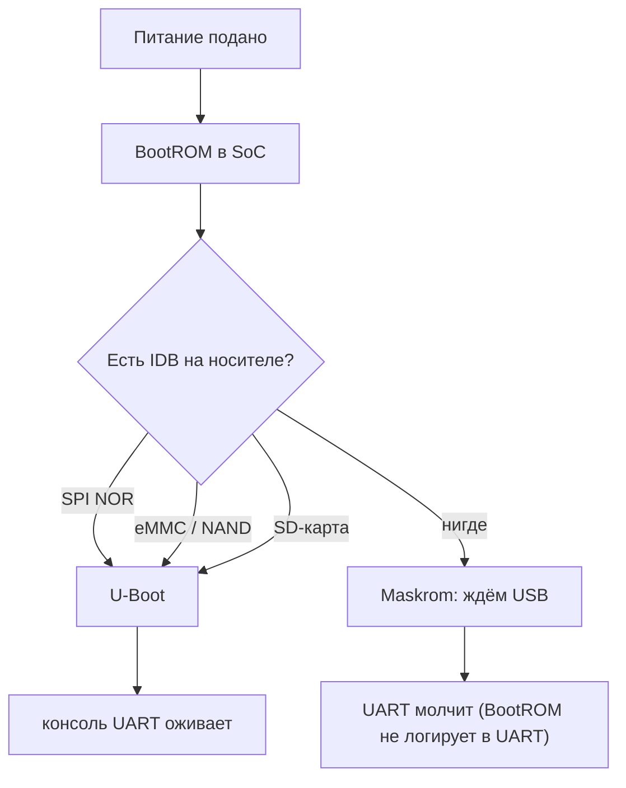

# RK3566: BootROM, носители и Maskrom

> [!abstract] Суть
> SoC не «загружает код из ниоткуда»: BootROM ищет IDB (начальный загрузчик) на одном из носителей — SPI NOR, eMMC/NAND, SD, USB. Если валидного IDB нет нигде, BootROM уходит в режим Maskrom и ждёт команды по USB, а по UART молчит. Поэтому на плате без eMMC и без SD-карты горящий `SYS` означает ровно питание, а тишина в консоли — отсутствие загрузчика, а не неисправность UART.

## Что происходит при включении

| Носитель | Есть на нашей плате | Что даёт |
|---|---|---|
| SPI NOR | **не обнаружен** (2026-11-11: `flashsize = 0`, env «from nowhere») | — путь закрыт, остаются SD и Maskrom |
| eMMC / NAND | нет (осознанно, см. README) | — |
| SD-карта | **есть** (2026-11-11): карта + ридер | вендорский образ: idbloader + U-Boot + Linux |
| USB (Maskrom) | зависит от порта | аварийный путь, загрузка лоадера в RAM |

> [!warning] Порядок сред
> Rockchip BootROM перебирает носители по приоритету; обычно это SPI NOR → eMMC/NAND → SD → USB. Точный порядок и условия перехода в Maskrom для RK3566 сверить по TRM (глава Boot), а не переносить по памяти с других SoC.

## Почему тишина в UART — это норма

- BootROM не выводит диагностику в UART: он либо нашёл IDB, либо молча ушёл в Maskrom.
- `SYS` на платах FriendlyElec — индикатор питания/состояния, не «признак загруженного Linux».
- Отсюда правило: **тишина до первого загрузчика не диагностируется по UART**. Сначала появляется носитель, потом консоль.

## Как проверить, что SoC жив и дошёл до Maskrom

1. **Визуально:** есть ли на плате 8-выводная микросхема SPI NOR (SOIC-8) рядом с SoC. Если её нет — остаются SD и USB.
2. **USB:** подключить порт с поддержкой данных (OTG) к ПК и посмотреть `lsusb` — устройство Rockchip с VID `2207:…` означает, что BootROM в Maskrom. Порт «только питание» этого не покажет.
3. **Кнопка `MASK`/`MASKROM`:** если она есть на плате, Maskrom вызывается зажатием при подаче питания.

> [!question] Проверить на плате
> Есть ли распаянный SPI NOR (визуально и `sf probe`). Остальное уже подтверждено.

> [!success] Подтверждено на плате (2026-11-11)
> - ПК видит устройство `Fuzhou Rockchip Electronics Company`, PID `350a` (VID `2207`) — SoC жив, BootROM дошёл до Maskrom, USB-канал данных работает.
> - Кнопка `MASK` на плате есть — Maskrom вызывается предсказуемо.
> - SD-карта и картридер есть — путь A доступен, порядок в [[sd_card_image]].
> - SD-загрузка работает: SPL 2025.10 → BL31 (TF-A v2.3) → U-Boot 2025.10; лог `Trying to boot from MMC2`, FIT с `atf`/`u-boot`/`fdt` проверен по sha256.
> - Env не сохраняется: `Loading Environment from nowhere`, `flashsize = 0` — SPI NOR нет, `saveenv` некуда.

## USB: три разные роли

«Работать через USB» — это три разных механизма, и путать их нельзя:

| Роль | Когда доступна | Что даёт | Чего не даёт |
|---|---|---|---|
| **Maskrom** (`rkdeveloptool`, `upgrade_tool`) | сейчас | загрузить лоадер в RAM (`db`), читать/писать носители (`wl`/`rd`, выбор через `cs`), сброс | консоль, сеть, запуск своего `bin` |
| **USB host в U-Boot** | после загрузки U-Boot | `usb start; fatload usb 0:1 <addr> fw.bin` — альтернатива TFTP | только если U-Boot собран с USB-хостом |
| **USB gadget в Linux** | после загрузки Linux (SD) | `ttyACM` на ПК вместо CH340 | обычно выключен в вендорском образе |

Почему наш образ напрямую через Maskrom не грузится: BootROM и вендорский лоадер ждут Rockchip IDB с DDR-инициализацией и своим заголовком, а не произвольный ELF/`bin`. И тишина в UART при Maskrom — норма: BootROM туда не логирует.

Практический вывод: USB — аварийный/прошивочный канал; рабочий цикл — UART (логи) + Ethernet (TFTP + `go`); носитель — SD.

> [!warning] Набор команд rkdeveloptool
> Зависит от версии утилиты и загруженного лоадера (`ld`/`db`/`cs`/`wl`). Сверять с `rkdeveloptool --help`, а не по памяти.

## Что делать: два пути

### Путь A — SD-карта (рекомендуется)

1. Карта 8–16 ГБ + картридер — **есть** (2026-11-11).
2. Вендорский образ FriendlyElec (содержит idbloader, U-Boot, Linux) записать на карту (`dd`/balenaEtcher) — порядок в [[sd_card_image]].
3. Вставить, подать питание с открытой консолью 1500000 8N1.

Что это даёт сразу:

- баннер U-Boot и его команды → [[h0_fact_sheet]] H0a/H0b;
- Linux: `/proc/iomem`, `/proc/device-tree` (`dtc -I fs`), `dmesg` про EL и `arch_timer` → закрывает факты, которых U-Boot не знает;
- рабочий канал H1: TFTP + `go` своего образа, SD остаётся точкой восстановления.

### Путь B — Maskrom без SD

Зажать Maskrom, подключить USB, загрузить вендорский `MiniLoaderAll.bin` (`rkdeveloptool db`). Лоадер инициализирует DDR и обычно печатает в UART — это подтверждает и линию, и DRAM.

Ограничения:

- это не полноценный U-Boot: загрузить по TFTP свой образ из Maskrom-лоадера нельзя;
- для H1 всё равно нужен носитель;
- лоадер обязан соответствовать SoC и типу DRAM (RK3566 + LPDDR4/4X), иначе падение на инициализации DDR.

## Практические следствия

- Этап H0a (баннер) **заблокирован** до появления носителя — это не ошибка в коде и не «не тот UART».
- Пока карты нет, полезно закрыть проверку самой линии: loopback адаптера ([[serial_console]]) — он не зависит от платы.
- Прошивку SPI NOR руками не трогать: без карты это единственный оставшийся путь восстановления, и его легко потерять.

> [!warning] Не делать
> - Не начинать с правки `board.rs`/линкера: адреса всё равно не проверить без загрузчика.
> - Не прошивать SPI NOR «на всякий случай» непроверенным образом.
> - Не считать, что «тишина = мёртвый UART», пока нет носителя.

## Источники
- TRM RK3566: глава Boot (порядок сред, Maskrom, IDB).
- Rockchip: `rkdeveloptool` (`db`, `wl`, `rd`), требования к `MiniLoaderAll.bin`.
- Wiki FriendlyElec (NanoPi R3S): образы, SD-загрузка, Maskrom.

## Связанные заметки
- [[board_bringup]], [[h0_fact_sheet]], [[sd_card_image]], [[serial_console]], [[uboot_loading]], [[load_address]], [[address_sources]]
