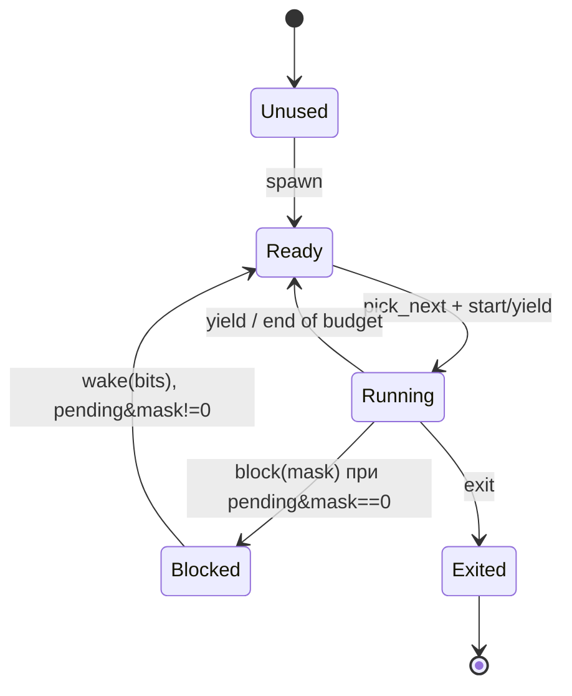

# Шаг 0.1: policy-скелет планировщика

> [!abstract] Суть
> 0.1 — это **только данные и правила**: `Task`/`TaskState`/`Scheduler`, приоритеты, `Blocked` + `pending`/`wait_mask`, `TaskContext` как раскладка (без asm). Никаких переключений, стеков и IRQ: `Scheduler` живёт локальной переменной в selftest, поведение прошивки не меняется. База — [[stage5_tdd]] (round-robin уже расписан там); здесь — **дельта**: приоритеты, `Blocked`, события и TCB.

## Что входит в шаг

| Входит | Не входит (0.2+) |
|---|---|
| типы и инварианты | `sched_switch`, стеки, `eret` |
| `spawn`/`start`/`yield`/`exit` | статический `Scheduler`, блокировки |
| приоритет в `pick_next` | вытеснение, квант |
| `try_wait`/`block`/`wake` (логика) | `wait` как блокирующий вызов (нужен switch) |
| `TaskContext` + `offset_of!`-asserts | заполнение контекста и прыжок в `entry` |

## Состояния



Правила, которые надо закодировать явно:

- `Unused` — единственное состояние, в котором слот можно занять (`spawn`).
- `Running` ровно один или ноль (`current: Option<usize>`).
- `Blocked` всегда имеет `wait_mask != 0`.
- `Exited` слот **не переиспользуется** на этом шаге (упрощение; см. «Открытые вопросы»).

## Типы

```rust
pub const MAX_TASKS: usize = 8;

pub type EventSet = u32;

/// Меньше значение — выше приоритет (как у GIC). Newtype, чтобы нельзя было
/// случайно передать произвольное число вместо уровня.
#[derive(Clone, Copy, PartialEq, Eq, PartialOrd, Ord, Debug)]
pub struct Prio(u8);

impl Prio {
    pub const DP: Self = Self(0);
    pub const CP: Self = Self(10);
    pub const IDLE: Self = Self(255);

    pub const fn new(raw: u8) -> Self { Self(raw) }
    pub const fn get(self) -> u8 { self.0 }
}

#[derive(Clone, Copy, PartialEq, Eq, Debug)]
pub enum TaskState {
    Unused,
    Ready,
    Running,
    Blocked,
    Exited,
}

/// Раскладка для sched_switch. Asm появится в 0.2, поля — уже сейчас:
/// смещения проверяются const-assert'ом, чтобы asm и Rust не разъехались.
#[repr(C)]
#[derive(Clone, Copy, Default)]
pub struct TaskContext {
    pub x19: u64, pub x20: u64, pub x21: u64, pub x22: u64,
    pub x23: u64, pub x24: u64, pub x25: u64, pub x26: u64,
    pub x27: u64, pub x28: u64, pub x29: u64, pub x30: u64,
    pub sp: u64,
}

const _: () = assert!(core::mem::offset_of!(TaskContext, sp) == 96);

pub struct Task {
    pub ctx: TaskContext,
    pub state: TaskState,
    pub prio: Prio,
    pub wait_mask: EventSet,
    pub pending: EventSet,
    pub entry: Option<extern "C" fn() -> !>,
    pub stack_top: usize,       // выровнен на 16
    pub name: &'static str,     // для логов, без аллокаций
}
```

`TaskContext` на этом шаге — «договор о раскладке», а не рабочий контекст: `x30`/`sp` заполнит 0.2. Смысл в том, чтобы `offset_of!` упал **на компиляции**, если кто-то переставит поля.

## `Scheduler`

```rust
pub struct Scheduler {
    tasks: [Task; MAX_TASKS],
    current: Option<usize>,
    cursor: usize,
}

impl Scheduler {
    pub const fn new() -> Self {
        Self {
            tasks: [const { Task::UNUSED }; MAX_TASKS],
            current: None,
            cursor: 0,
        }
    }
}
```

- `[const { Task::UNUSED }; MAX_TASKS]` — inline-const в повторе массива, `Task: Copy` не требуется.
- `Scheduler` **не** `Copy` и пока не статик: в 0.1 он создаётся локально (в selftest). Глобальный `static` + `IrqSafeSpinLock` — шаг 0.2.

### API

```rust
pub enum BlockResult {
    /// Сон принят; `next` — кого запускать (`None` = idle).
    Blocked { next: Option<usize> },
    /// Не перешли в Blocked: не Running или событие уже залатчено.
    NotBlocked,
}

impl Scheduler {
    pub fn spawn(
        &mut self,
        entry: extern "C" fn() -> !,
        name: &'static str,
        prio: Prio,
        stack_top: usize,
    ) -> Option<usize>;

    pub fn start(&mut self) -> Option<usize>;
    pub fn current(&self) -> Option<usize>;
    pub fn state(&self, id: usize) -> TaskState;

    pub fn yield_current(&mut self) -> Option<usize>;
    pub fn exit_current(&mut self) -> Option<usize>;

    /// Неблокирующая проверка событий текущей задачи.
    pub fn try_wait_current(&mut self, mask: EventSet) -> Option<EventSet>;

    /// Running → Blocked + выбрать следующую.
    pub fn block_current(&mut self, mask: EventSet) -> BlockResult;

    /// Ставит биты задаче (из ISR/таймера); может перевести Blocked → Ready.
    pub fn wake(&mut self, id: usize, bits: EventSet) -> bool;

    fn pick_next(&mut self) -> Option<usize>;
    pub fn assert_invariants(&self);
}
```

### Почему `try_wait` + `block`, а не `wait`

блокирующий `wait(mask)` обязан переключить стек — это механизм, а не политика. В policy-слое корректно разделить:

1. `try_wait_current(mask)` — неблокирующий: если `pending & mask != 0`, **снять только эти биты** и вернуть их; иначе `None`.
2. `block_current(mask)` — перевести `Running → Blocked`, записать `wait_mask` и сразу выбрать следующую задачу. Возвращает `Blocked { next }` или `NotBlocked`.

`block_current` **отказывает**, если `pending & mask != 0`: событие уже пришло, спать нельзя. Это переносит защиту «событие до ожидания» из дисциплины вызывающего в саму политику.

Оба метода работают только с текущей задачей — поэтому в API нет `id`; так исключается класс ошибок «разбудили/усыпили не ту задачу». Композиция с защитой от гонки появится в 0.4 (firmware): `try_wait_current` → маска IRQ → `block_current` → если вернулся `NotBlocked`, switch отменяется. В 0.1 проверяется только логика.

### Семантика событий

| Ситуация | `pending` | Состояние | Возврат `wake` |
|---|---|---|---|
| задача `Running`, событие пришло | `\|= bits` (латчится) | не меняется | `false` |
| задача `Ready`, событие пришло | `\|= bits` | не меняется | `false` |
| `Blocked`, `pending & wait_mask != 0` | `\|= bits` | `→ Ready`, `wait_mask = 0` | `true` |
| `Blocked`, биты не те | `\|= bits` | остаётся `Blocked` | `false` |
| `Unused`/`Exited` | **не трогаем** | не меняется | `false` |

Латчинг для `Running` — это и есть защита «событие не потерялось»: задача проснётся не от `wake`, а на следующем `try_wait_current`.

> [!warning] `block_current` не «съедает» уже пришедшие события
> Если `pending & mask != 0`, `block_current` обязан вернуть `NotBlocked`, оставив задачу `Running`. Иначе залатченное событие никогда не разбудит задачу: она уснёт с непустым `pending`, а нового `wake` не будет.

### Приоритет и round-robin

Алгоритм `pick_next`:

1. Найти минимальный `prio` среди `Ready` (`min()`, не «первый встреченный»).
2. Среди `Ready` с этим `prio` — обойти от `cursor`, вернуть первый, сдвинуть `cursor = id + 1`.
3. `Blocked`/`Exited`/`Unused`/`Running` пропускаются.

Так получаются оба свойства: строгий приоритет (DP никогда не ждёт CP, если сам Ready) и честность внутри уровня. Голодание CP — известное следствие строгого приоритета; лечится бюджетом DP в 0.4, а не эвристикой в `pick_next`.

### Инварианты (`assert_invariants`)

- `current == None` ⇒ нет ни одной `Running`; `current == Some(id)` ⇒ `tasks[id].state == Running`.
- `Running` не больше одного.
- `Ready`/`Running`/`Blocked` ⇒ `stack_top != 0`, `stack_top % 16 == 0`, `entry.is_some()`.
- `Blocked` ⇒ `wait_mask != 0`.
- `Ready`/`Running` ⇒ `wait_mask == 0`.
- `Unused` ⇒ `entry == None`, `stack_top == 0`, `pending == 0`.
- `Exited` ⇒ `entry == None`, `pending == 0`, `wait_mask == 0`.
- `current == Some(id)` ⇒ `tasks[id].state == Running`; `Blocked`-задача не может быть `current`.
- `spawn` занимает только `Unused`; слот `Exited` не переиспользуется.

Вызывать только из selftest/debug: в горячем пути — никогда.

## `spawn`: контракт и детали

`spawn` — единственная операция, создающая задачу. Она **не запускает** её, не выбирает следующую и не трогает текущую.

### Пошагово

1. Проверить `stack_top`: не ноль и кратен 16.
2. Найти первый слот в состоянии `Unused`; если такого нет — вернуть `None`.
3. **Целиком** присвоить слоту новую `Task`.
4. Вернуть `Some(id)`.

### Почему так, а не иначе

| Решение | Причина |
|---|---|
| `position(\|t\| t.state == Unused)` | `Exited` не переиспользуется (принятое решение); `?` даёт `None` при заполнении без паники |
| Присваивать всю `Task`, а не поля по одному | слот не наследует мусор: `pending`/`wait_mask`/`entry` точно сброшены |
| `state = Ready`, не `Running` | выбирает `start()`/`pick_next`; `spawn` не вытесняет и не задаёт `current` |
| `pending = 0`, `wait_mask = 0` | новая задача не должна «помнить» чужие события |
| `ctx = TaskContext::default()` в 0.1 | смысл `sp`/`x30` зависит от соглашения `sched_switch`, которого ещё нет; заполним в 0.2 |
| `name: &'static str` | без аллокаций и без времени жизни |
| `cursor` не трогаем | иначе порядок round-robin зависел бы от момента `spawn` |
| `assert` на `stack_top` | `spawn` не горячий путь; битый стек фатален, лучше упасть при инициализации |

### Код для 0.1

```rust
pub fn spawn(
    &mut self,
    entry: extern "C" fn() -> !,
    name: &'static str,
    prio: Prio,
    stack_top: usize,
) -> Option<usize> {
    assert_ne!(stack_top, 0, "stack_top must be non-zero");
    assert_eq!(stack_top % 16, 0, "stack_top must be 16-byte aligned");

    let id = self
        .tasks
        .iter()
        .position(|task| task.state == TaskState::Unused)?;

    self.tasks[id] = Task {
        ctx: TaskContext::default(),
        state: TaskState::Ready,
        prio,
        wait_mask: 0,
        pending: 0,
        entry: Some(entry),
        stack_top,
        name,
    };

    Some(id)
}
```

### Что появится в 0.2

- `ctx.sp = stack_top as u64`;
- `ctx.x30 = entry as usize as u64`;
- `sched_switch` восстановит регистры и `sp`, затем сделает `ret` — первый «возврат» попадёт в `entry`. Поэтому сигнатура `-> !`: возвращаться ей некуда.
- Вызовы `spawn` обязаны быть **до** `daifclr`: после 0.4 ISR читает `pending`/`READY`, и полуинициализированный слот нельзя показывать прерыванию.

### Ловушки

> [!warning]
> - Забыть `pending = 0` — задача «проснётся» от события, которого не ждала (если слот когда-нибудь переиспользуют).
> - Присваивать поля по одному — легко оставить `entry: None` или `wait_mask` от предыдущего содержимого; `assert_invariants` это поймает, но позже.
> - `stack_top == 0` проходит проверку `% 16 == 0`, но ломает инвариант `Ready ⇒ stack_top != 0`. Проверять оба условия.
> - Ставить `current` в `spawn` — ломает инвариант «ровно один `Running`» и ломает `start()`.
> - `position` + индексация: заимствование заканчивается на `position`, поэтому `self.tasks[id] = …` компилируется; через `iter_mut().find` пришлось бы считать `id` через `enumerate`.
> - Clippy может предложить `stack_top.is_multiple_of(16)` (Rust ≥ 1.87) — это нормально.

### Самопроверка

> [!question]
> - Почему `spawn` возвращает `Option`, а не паникует при заполненной таблице?
> - Что сломается, если поставить `state = Running` и `current = Some(id)` прямо в `spawn`?


## `pick_next`, `start`, `yield`, `exit`

### Почему в `pick_next` два прохода

1. Найти минимальный `Prio` среди `Ready`.
2. Внутри этого уровня — круг от `cursor`.

Один проход не работает ни в одном варианте:
- «первый `Ready` от `cursor`» игнорирует приоритет — CP может обогнать DP;
- `min()` по `(prio, id)` приоритет соблюдает, но всегда берёт меньший id и убивает round-robin.

```rust
fn pick_next(&mut self) -> Option<usize> {
    let best_prio = self
        .tasks
        .iter()
        .filter(|task| task.state == TaskState::Ready)
        .map(|task| task.prio)
        .min()?;

    for offset in 0..MAX_TASKS {
        let id = (self.cursor + offset) % MAX_TASKS;
        if self.tasks[id].state == TaskState::Ready && self.tasks[id].prio == best_prio {
            self.cursor = (id + 1) % MAX_TASKS;
            return Some(id);
        }
    }

    // Недостижимо: если best_prio найден, хотя бы одна Ready есть.
    None
}
```

### `start` идемпотентен

```rust
pub fn start(&mut self) -> Option<usize> {
    if let Some(id) = self.current {
        return Some(id);
    }

    let id = self.pick_next()?;
    self.tasks[id].state = TaskState::Running;
    self.current = Some(id);
    Some(id)
}
```

Почему не `debug_assert!(current.is_none())`: randomized-тест вызывает `start` случайно, в том числе когда задача уже работает; в ядре идемпотентный вход безопаснее. Альтернатива — оставить строгий `start` и в модели вызывать его только при `current == None`.

### `yield_current`

```rust
pub fn yield_current(&mut self) -> Option<usize> {
    let current = self.current?;
    debug_assert_eq!(self.tasks[current].state, TaskState::Running);

    self.tasks[current].state = TaskState::Ready;

    // current только что стал Ready — выбор обязан что-то найти.
    let next = self.pick_next().expect("current was just made Ready");

    self.tasks[next].state = TaskState::Running;
    self.current = Some(next);
    Some(next)
}
```

### `exit_current`

```rust
pub fn exit_current(&mut self) -> Option<usize> {
    let current = self.current?;
    debug_assert_eq!(self.tasks[current].state, TaskState::Running);

    self.tasks[current].state = TaskState::Exited;
    self.tasks[current].entry = None;
    self.tasks[current].pending = 0;
    self.tasks[current].wait_mask = 0;

    match self.pick_next() {
        Some(next) => {
            self.tasks[next].state = TaskState::Running;
            self.current = Some(next);
            Some(next)
        }
        None => {
            self.current = None;
            None
        }
    }
}
```

`ctx`/`stack_top`/`prio` чистить не обязательно: слот не переиспользуется, инвариант `Exited` их не ограничивает. Чистка `ctx` станет нужна, только если позже разрешите повторный `spawn`.

> [!warning] Заимствования
> Присваивайте поля через `self.tasks[current]…` по одному. Если взять `let task = &mut self.tasks[current]` и потом вызвать `self.pick_next()`, borrow checker не пропустит.

> [!question] Что дальше
> После этих четырёх пройдут `states`, `round-robin`, `priority`; следующая паника будет в `try_wait_current` (группа `events`).

## `wake`, `try_wait_current`, `block_current`

Три операции, которые превращают таблицу состояний в event-планировщик.

### `wake`

```rust
pub fn wake(&mut self, id: usize, bits: EventSet) -> bool {
    let task = &mut self.tasks[id];

    // 1. Несуществующая/завершённая задача не латчит события.
    if matches!(task.state, TaskState::Unused | TaskState::Exited) {
        return false;
    }

    // 2. Латчим всегда: событие не теряется, даже если задача уже Running.
    task.pending |= bits;

    // 3. Будим только Blocked и только если накопилось то, чего ждали.
    if task.state == TaskState::Blocked && (task.pending & task.wait_mask) != 0 {
        task.state = TaskState::Ready;
        task.wait_mask = 0;
        return true;
    }

    false
}
```

- Порядок проверок важен: guard **до** `pending |= bits`, иначе событие переживёт `exit` и «всплывёт» у чужой задачи.
- Сверяем **накопленный** `pending`, а не `bits`: маску ожидания может закрыть бит, пришедший раньше.
- `true` — это факт перехода `Blocked → Ready`, а не «биты приняты». `Running`/`Ready` получают `false`.
- `wait_mask = 0` при пробуждении — чтобы держался инвариант `Ready ⇒ wait_mask == 0`.
- `id` вне `0..MAX_TASKS` — паника по индексации; id всегда берётся из `spawn`.

### `try_wait_current`

```rust
pub fn try_wait_current(&mut self, mask: EventSet) -> Option<EventSet> {
    let current = self.current?;
    if self.tasks[current].state != TaskState::Running {
        return None;
    }

    let hit = self.tasks[current].pending & mask;
    if hit == 0 {
        return None;
    }

    self.tasks[current].pending &= !hit;
    Some(hit)
}
```

- Снимаем только `hit`, остальные биты остаются: событие другого класса не должно пропасть.
- Только `Running`: у `Ready`/`Blocked` «ожидание» не имеет смысла (сон — отдельная операция).
- `!hit` — побитовое НЕ в пределах `u32`; `hit` уже ограничен `mask`, поэтому лишние биты не тронутся.

### `block_current`

```rust
pub fn block_current(&mut self, mask: EventSet) -> BlockResult {
    debug_assert_ne!(mask, 0, "blocking with empty mask would never wake");

    let Some(current) = self.current else {
        return BlockResult::NotBlocked;
    };

    if self.tasks[current].state != TaskState::Running {
        return BlockResult::NotBlocked;
    }

    // Событие уже пришло — спать нельзя.
    if (self.tasks[current].pending & mask) != 0 {
        return BlockResult::NotBlocked;
    }

    self.tasks[current].wait_mask = mask;
    self.tasks[current].state = TaskState::Blocked;

    // current больше не Running — сразу выбрать следующего.
    let next = self.pick_next();
    match next {
        Some(next) => {
            self.tasks[next].state = TaskState::Running;
            self.current = Some(next);
        }
        None => self.current = None,
    }

    BlockResult::Blocked { next }
}
```

- Все проверки — **до** изменения состояния: иначе отказ (`NotBlocked`) оставил бы задачу `Blocked` без маски и сломал инвариант.
- `pick_next` вызывается после перевода в `Blocked`, поэтому сама задача выбрана быть не может.
- `next == None` — «готовых нет, идём в idle»; в 0.1 idle-задачи ещё нет, `current = None`.

> [!warning] `mask == 0`
> Сон с пустой маской не разбудит никто: `pending & 0 == 0` навсегда. Поэтому `debug_assert_ne!`: в релизе такой вызов станет вечным сном, не передавайте 0.

> [!question] Что дальше
> После этих трёх `events` и `model` должны пройти, а `todo!()` в файле не останется.

## Selftest (QEMU, feature `selftest`)

Файл `src/selftest/test_sched.rs`, вызов — между `test_sync::run()` и `test_heap::run()`.

| # | Сценарий | Ожидание |
|---|---|---|
| 1 | `new()` | `current == None`, `start() == None` |
| 2 | `spawn` × 3 | id 0,1,2; все `Ready` |
| 3 | `start` | выбран id 0, `Running` |
| 4 | `yield` × 3 | 1 → 2 → 0 |
| 5 | `yield` при одной задаче | возвращает её же |
| 6 | `exit` последней | `current == None` |
| 7 | `spawn` сверх `MAX_TASKS` | `None`, без паники |
| 8 | `prio`: CP(id 0), DP(id 1) | `pick_next` отдаёт DP |
| 9 | `block_current` без `pending` | `Blocked { next }`, `wait_mask` записан |
| 10 | `wake` своим битом | `Blocked → Ready` |
| 11 | `pending` до `block_current` | `NotBlocked`, задача осталась `Running` |
| 12 | `pending = A\|B`, `try_wait_current(A)` | вернул `A`, `B` остался в `pending` |
| 13 | `wake` чужим битом | остаётся `Blocked`, `pending` содержит бит |
| 14 | `wake` для `Unused`/`Exited` | `false`, `pending == 0` |
| 15 | все слоты `Exited`, затем `spawn` | `None` (переиспользования нет) |

Стеки в 0.1 фиктивные: `stack_top = 0x8000 + N*0x1000` (кратно 16). Реальные `static`-стеки появятся в 0.2 — сигнатура `spawn` уже готова.

Ожидаемый вывод — строки в стиле существующего selftest:

```text
  sched: states ok
  sched: round-robin ok
  sched: priority ok
  sched: events ok
```

## Порядок реализации

1. Типы + `Task::UNUSED` + `Scheduler::new()` → собирается, логики нет.
2. `spawn` + `pick_next` (приоритет) + `start` → тесты 1–3, 7, 8, 15.
3. `yield_current` + `exit_current` → тесты 4–6.
4. `try_wait_current` + `block_current` + `wake` → тесты 9–14.
5. `assert_invariants` во всех тестах; `fmt`/`clippy`.

## DoD шага

**Закрыт 2026-11-05.** Проверено: сборка зелёная, selftest печатает все пять `sched: … ok`, `clippy -D warnings` и `fmt --check` чисты, `todo!()` не осталось.

- [x] `cargo build` зелёный;
- [x] `cargo run --features selftest` печатает все `sched: … ok`;
- [x] обычный `cargo run` — вывод не изменился (по коду: вне `selftest` планировщик не вызывается);
- [x] `cargo clippy --bin bare-metal-firewall --features selftest` чист;
- [x] `cargo fmt --check` чист;
- [x] нет `todo!()`/`unimplemented!()`;
- [x] `#![allow(dead_code)]` в `scheduler.rs` помечен `TODO(0.2)`; при feature-гейте снимается на 0.3, когда планировщик станет безусловным ([[stage5_0_2_switch]]).

## Подводные камни

> [!warning]
> - **`#![allow(dead_code)]` временный.** В 0.2 `spawn`/`start` начнут вызываться из `main`, allow надо снять, иначе он спрячет реальный мусор.
> - **`TaskState` без `Default`.** Не пытайтесь `#[derive(Default)]` на `Task`: `Unused` — осмысленное начальное состояние, а не «ноль по умолчанию».
> - **`spawn` не должен затирать `Exited`.** Иначе «переиспользование слота» случится случайно, без сброса `ctx`/`pending`.
> - **`wake` для `Unused`.** Без guard'а латчится событие в несуществующую задачу, и после `spawn` оно «всплывёт».
> - **`try_wait` снимает только `pending & mask`.** Снять весь `pending` — потерять события других классов.
> - **Направление приоритета.** «Меньше = выше» выбрано ради согласованности с GIC; если перепутать, DP и CP поменяются местами молча.
> - **`min()` по `(prio, id)`** даёт детерминированный выбор, но не должен подменять round-robin внутри уровня — курсор всё равно нужен.
> - **`assert_invariants` — не для релиза.** В горячем пути это лишние циклы по 8 слотам.

## Принятые решения (2026-10)

1. **Слоты `Exited` не переиспользуются.** `spawn` ищет только `Unused`; `MAX_TASKS` — жёсткий лимит на всё время работы. Переиспользование потребовало бы полного сброса `ctx`/`pending`/`wait_mask`/`entry` и легко приводит к «всплывшим» событиям.
2. **`Prio` — newtype** `struct Prio(u8)` с константами `DP`/`CP`/`IDLE`. Сравнение по сырому значению, меньше = выше.
3. **Биты событий — отдельный модуль `events`**, появится в 0.4 вместе с реальными источниками (`NET_RX`, `TICK`, `TX_DONE`). До этого `EventSet = u32`, тесты используют литералы.
4. **`block_current` отказывает, если событие уже залатчено** — самый частый баг event-планировщиков закрыт на уровне политики.
5. **События/блокировка — только для текущей задачи** (`try_wait_current`/`block_current` без `id`).

## Открытые вопросы

> [!question]
> - Достаточно ли `MAX_TASKS = 8` с учётом запрета переиспользования? Если появятся краткоживущие задачи, лимит придётся пересмотреть.

## Связанные заметки
- [[stage5_tdd]], [[stage5_policy_testing]], [[stage5_scheduler]], [[task_and_scheduler]], [[context_switch]], [[roadmap_5_12]], [[0009_hybrid_scheduling]], [[no_std_testing]]
